# Mockups index

Layout and workflow reference for the Optrizo CRM. **These mockups define what each screen contains and how the workflow moves, not the final visual design.**

Each entry has a screenshot (`.png`) and the HTML it was drawn from (`html/…`, useful for reading exact labels and structure). The notes come from the design canvas.

Numbering: plain numbers (1–31) are the main client path in time order. A letter (18a, 26a) is another path from that step. `C1–C9` are Content Editor screens. `Ref` screens can be opened any time (dashboards, lists, notifications). Start with `00-workflow-overview`.

## Workflow Overview · Start Here

### 0 · Workflow overview: every role, every step

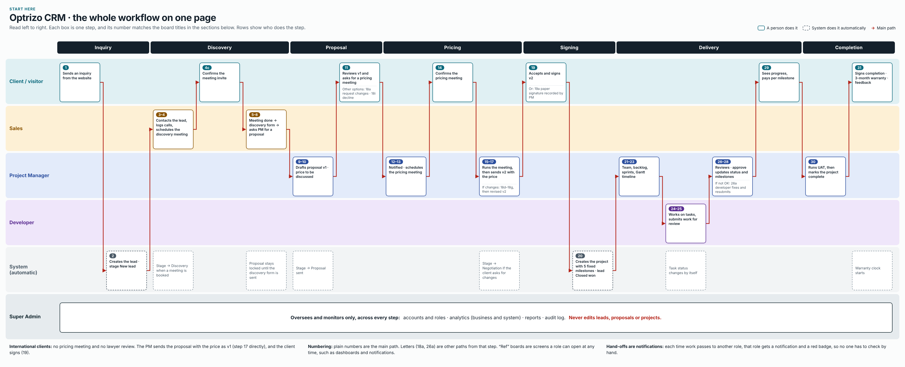

- Screenshot: `00-workflow-overview-start-here/001-0-workflow-overview-every-role-every-step.png`  ·  HTML: `html/00-workflow-overview-start-here/001-0-workflow-overview-every-role-every-step.html`

Notes

Where it is
The first board on the canvas, above every section. Its section title is “Workflow overview · start here”.

What it is
The whole Optrizo process on one page, as a swimlane diagram. Each row is a role: Client, Sales, Project Manager, Developer, System (automatic) and Super Admin. Each column is a phase: Inquiry, Discovery, Proposal, Pricing, Signing, Delivery, Completion. The red arrows show the main path from the first inquiry to the final sign-off.

Why it is needed
The panel's main reason for the redefense was that the workflow was unclear. The detailed screens are split by role, so on their own they never show the full journey or who hands work to whom. This board answers four questions in one look: what happens first, who does each step, what the system does by itself, and where Super Admin stands (watching only, never editing).

How it works
1. Start at box 1 (client sends an inquiry) and follow the red arrows.
2. Each box number matches the start of a board title below. For example, box 12–13 points to boards “12 · PM: pricing meeting request arrives” and “13 · PM: schedules the pricing meeting”.
3. Dashed boxes are things the system does by itself, such as moving the lead stage or creating the project. No one clicks anything for these.
4. Small grey lines inside a box name the other paths from that step, such as 18a (request changes) or 18i (decline).
5. Grey dashed chips in the System row show automatic stage changes.
6. The Super Admin bar runs under every phase because it monitors all of them and acts in none.
7. Footer: international clients skip the pricing meeting. The PM sends the priced proposal (17) as the first version.

Numbering rules for every board
• Plain number (e.g. 13) = main path, in time order.
• Number + letter (e.g. 18a) = another path that starts from that step.
• “Ref” = a screen the role can open any time (dashboard, notifications, lists).

Not shown in the swimlanes: the Content Editor (section C1–C7) manages the public website (services, portfolio, pages). It feeds step 1, because the inquiry form's Service list comes from the published services.

## Sign In (All Users)

### Sign in · Sign in page

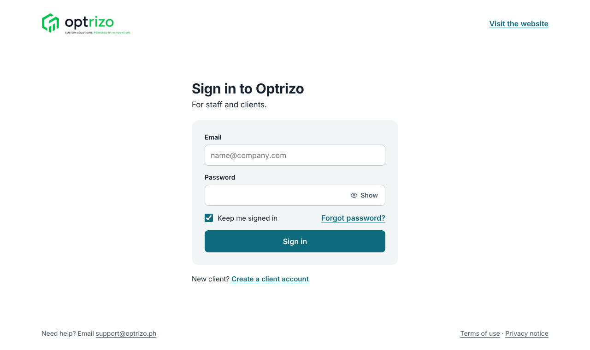

- Screenshot: `01-sign-in/002-sign-in-sign-in-page.png`  ·  HTML: `html/01-sign-in/002-sign-in-sign-in-page.html`

Notes

What it is
The one sign-in page for every staff role and for clients.

How it works
User enters email and password. The system reads the role on the account and opens that role's workspace. Staff accounts are created by the Super Admin; clients create their own.

Why it matters
One entry point means nobody switches accounts during a demo or real work, which the panel asked for.

Details
Staff accounts for Sales, Project Managers, Developers and Content Editors are created by the Super Admin. There is no public sign-up for staff.

### Sign in · Wrong email or password

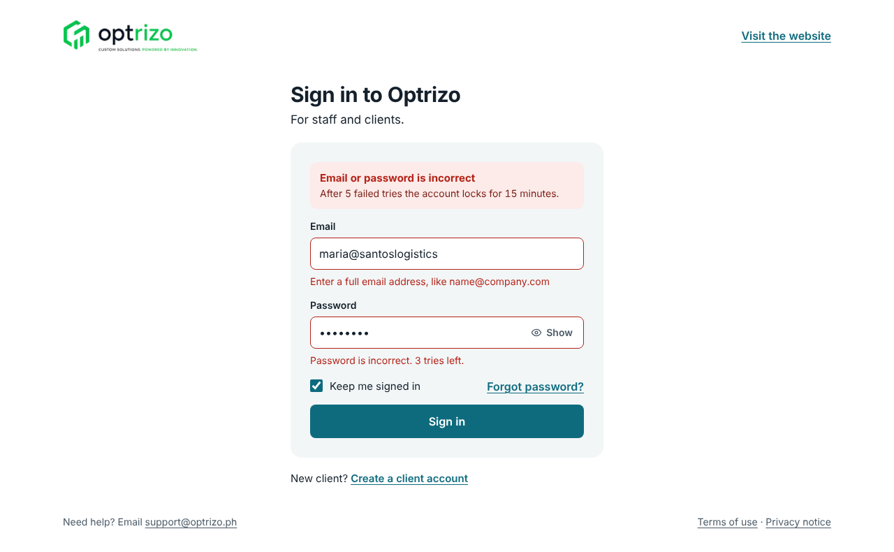

- Screenshot: `01-sign-in/003-sign-in-wrong-email-or-password.png`  ·  HTML: `html/01-sign-in/003-sign-in-wrong-email-or-password.html`
- How you get here: Click Sign in with a wrong password or a bad email

Notes

What it is
The sign-in page after a failed attempt.

How it works
Wrong password or a badly formed email shows a clear message next to the field. Repeated failures can lock the account for a short time.

Why it matters
Shows that sign-in is validated, one of the panel's points about account security.

### Sign in · Where each role lands

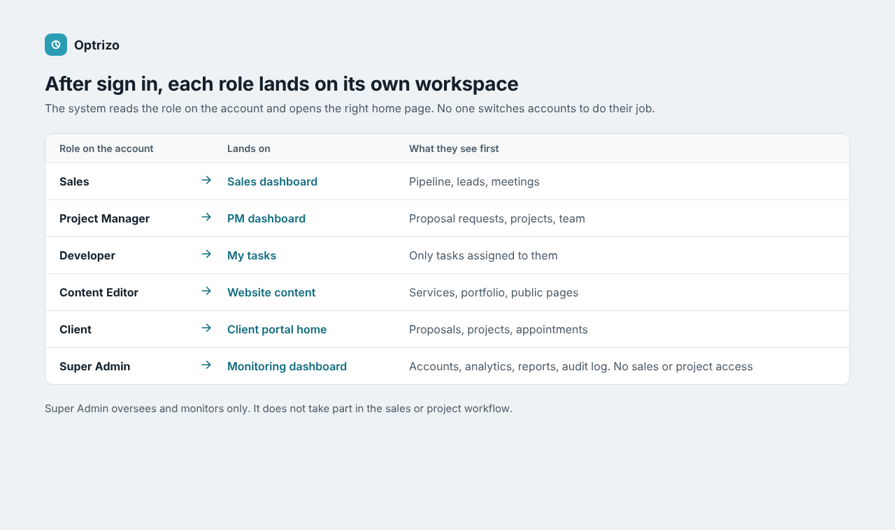

- Screenshot: `01-sign-in/004-sign-in-where-each-role-lands.png`  ·  HTML: `html/01-sign-in/004-sign-in-where-each-role-lands.html`
- How you get here: Click Sign in (details correct)
- Next: Each role opens its own section

Notes

What it is
A reference table of where each role lands after signing in.

How it works
Role on the account → home page: Sales → Sales dashboard, PM → PM dashboard, Developer → My tasks, Client → Client portal, Super Admin → monitoring only.

Why it matters
Answers the panel's question about what each user type does, in one view.

### Sign in · Create a client account

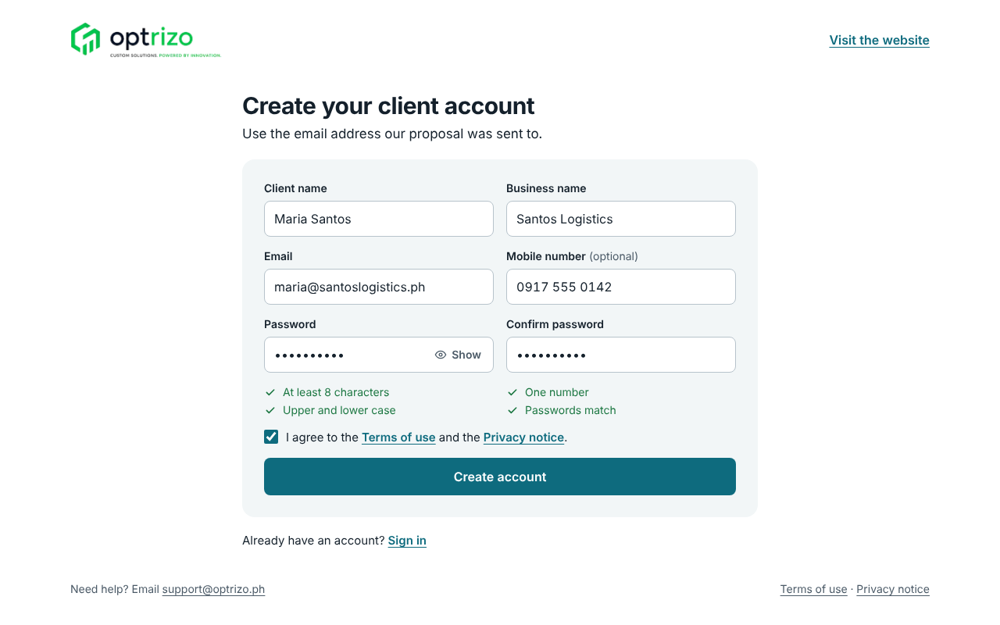

- Screenshot: `01-sign-in/005-sign-in-create-a-client-account.png`  ·  HTML: `html/01-sign-in/005-sign-in-create-a-client-account.html`
- How you get here: Click Create a client account (on the Sign in page)

Notes

What it is
Client account creation.

How it works
The client uses the same email the inquiry or proposal was sent to, so their proposals and projects link to the account automatically.

Why it matters
Clients get one place to follow their work instead of scattered emails.

### Sign in · Account form with errors

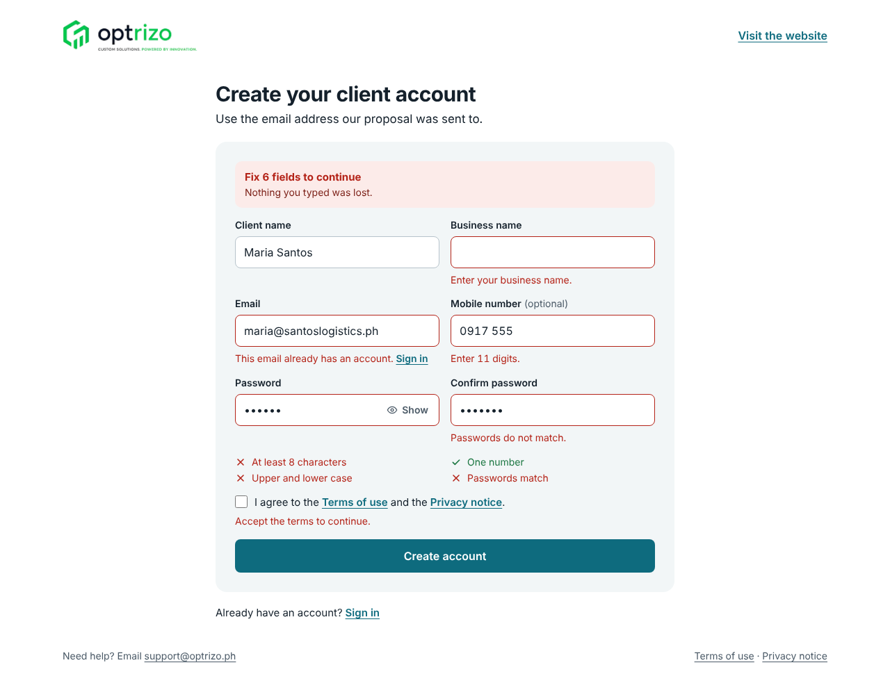

- Screenshot: `01-sign-in/006-sign-in-account-form-with-errors.png`  ·  HTML: `html/01-sign-in/006-sign-in-account-form-with-errors.html`
- How you get here: Click Create account with a missing or invalid field

Notes

What it is
The account form with validation errors.

How it works
Missing fields, a weak password, or a mismatched confirmation show errors next to each field before anything is saved.

Why it matters
Answers Ma'am Shai's comment that account creation had no validation.

### Sign in · Check your email

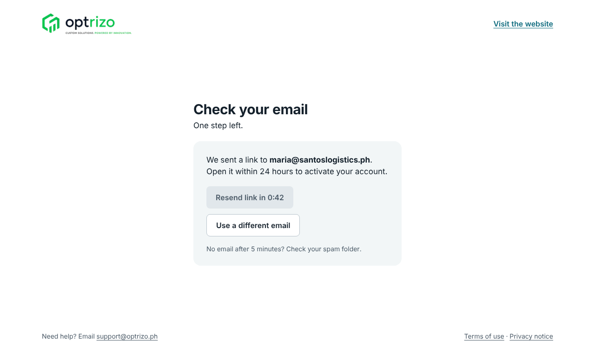

- Screenshot: `01-sign-in/007-sign-in-check-your-email.png`  ·  HTML: `html/01-sign-in/007-sign-in-check-your-email.html`
- How you get here: Click Create account (all fields valid)
- Next: After confirming: Client portal home (Client section)

Notes

What it is
The 'check your email' step after creating an account.

How it works
The system emails a confirmation link. The account works only after the client clicks it.

Why it matters
Stops someone else from opening a client's proposals with a fake account.

## Public Website (Visitor)

### 1 · Visitor: sends an inquiry from the website

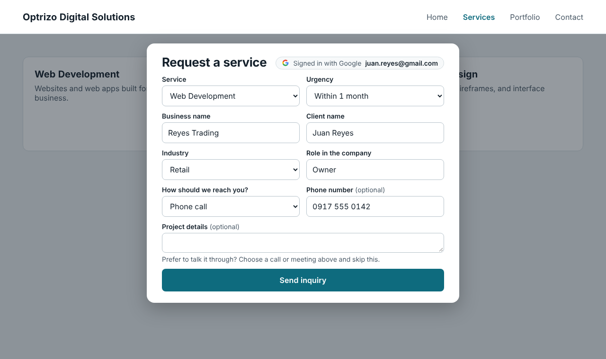

- Screenshot: `02-public-website/008-1-visitor-sends-an-inquiry-from-the-website.png`  ·  HTML: `html/02-public-website/008-1-visitor-sends-an-inquiry-from-the-website.html`
- Next: Inquiry lands in the Sales pipeline

Notes

What it is
The public website's service request form (inquiry).

How it works
A visitor picks a preset service, enters business name, timeline and details, then sends. The inquiry becomes a New lead card in the Sales pipeline automatically.

Why it matters
This is step 1 of the whole workflow. Services are preset, as Sir Ong asked, and come from the Content Editor’s Services list (C2), and there is no budget field or lead score.

### 1a · Visitor: inquiry for an “Other” service

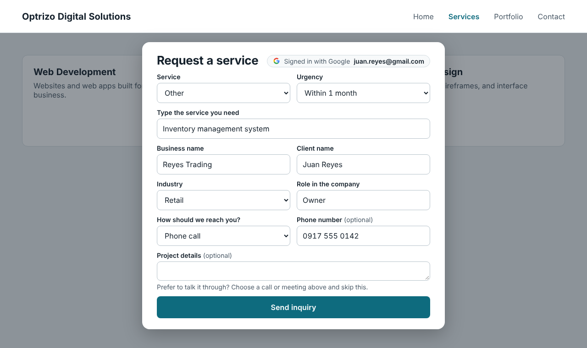

- Screenshot: `02-public-website/009-1a-visitor-inquiry-for-an-other-service.png`  ·  HTML: `html/02-public-website/009-1a-visitor-inquiry-for-an-other-service.html`
- How you get here: Choose Other in Service

Notes

What it is
The inquiry form when the service is not in the list.

How it works
Choosing Other opens a text box where the visitor types the service they need.

Why it matters
Keeps the service list short and fixed while still accepting unusual requests.

### 1b · Visitor: inquiry form with errors

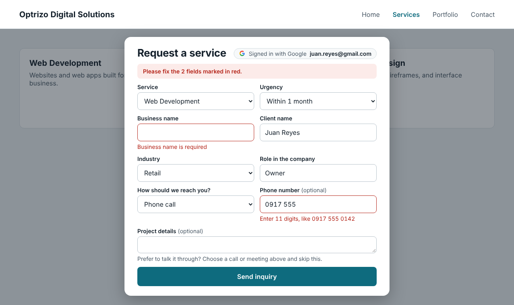

- Screenshot: `02-public-website/010-1b-visitor-inquiry-form-with-errors.png`  ·  HTML: `html/02-public-website/010-1b-visitor-inquiry-form-with-errors.html`
- How you get here: Click Send inquiry with a missing or invalid field

Notes

What it is
The inquiry form with validation errors.

How it works
Required fields left empty or an invalid email are flagged before sending.

Why it matters
Prevents incomplete leads from reaching Sales.

### 1c · Visitor: inquiry received

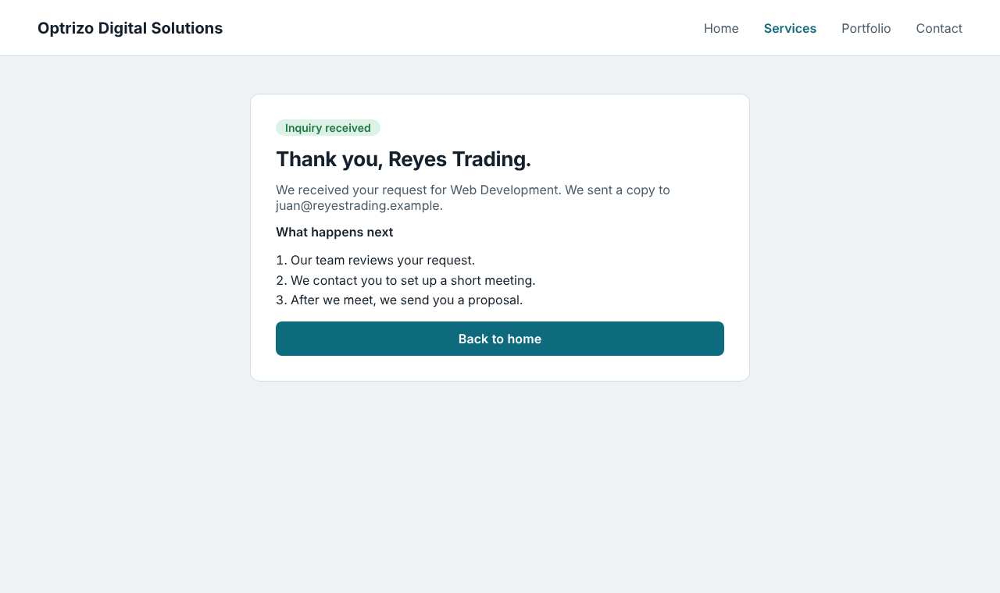

- Screenshot: `02-public-website/011-1c-visitor-inquiry-received.png`  ·  HTML: `html/02-public-website/011-1c-visitor-inquiry-received.html`
- How you get here: Click Send inquiry (all fields valid)

Notes

What it is
Confirmation after the inquiry is sent.

How it works
Shows what happens next: the team reviews the request, contacts the client to set a meeting, then prepares a proposal. A copy goes to the client's email.

Why it matters
Sets the client's expectations so they know a meeting comes before any proposal.

## Content Editor (Public Website Content)

### C1 · Content Editor: website content home

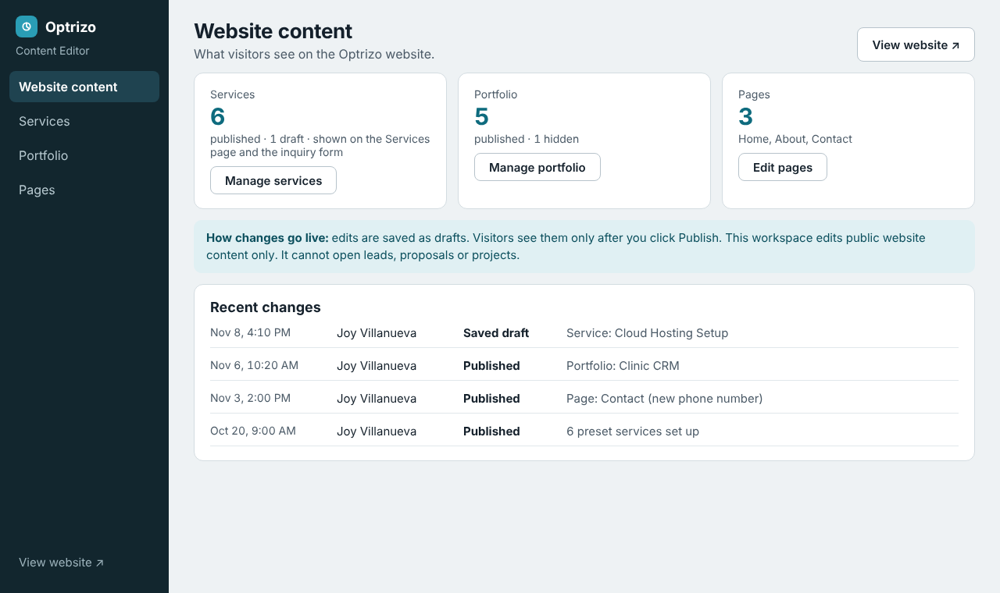

- Screenshot: `03-content-editor/012-c1-content-editor-website-content-home.png`  ·  HTML: `html/03-content-editor/012-c1-content-editor-website-content-home.html`
- How you get here: Content Editor signs in (lands here)

Notes

Where it is
New section “Content Editor (public website content)”, placed right after the Public Website section because it controls what visitors see there. First board, C1. The C numbers are separate from the main 1–31 path because content editing is not part of the client workflow.

What it is
The Content Editor's home after sign-in. It shows three content areas (Services, Portfolio, Pages), how many items in each are published, and a list of recent changes.

Why it is needed
“Public Content Management” is in the capstone title, so the panel needs to see it. This board also sets the scope clearly: it is a simple content manager for Optrizo's own website, not a website builder like Wix or WordPress. Visitors and evaluators can see exactly what is managed.

How it works
1. A Content Editor account is created by Super Admin (Add staff account, role Content Editor).
2. On sign-in the system opens this page (see Sign in · Where each role lands).
3. Each tile opens its area: Manage services (C2), Manage portfolio (C5), Edit pages (C7).
4. The teal box states the two rules: changes go live only after Publish, and this role cannot open leads, proposals or projects (see the Roles board).
5. Recent changes lists who changed what and when. The same events go to Super Admin's audit log.

### C2 · Content Editor: services list

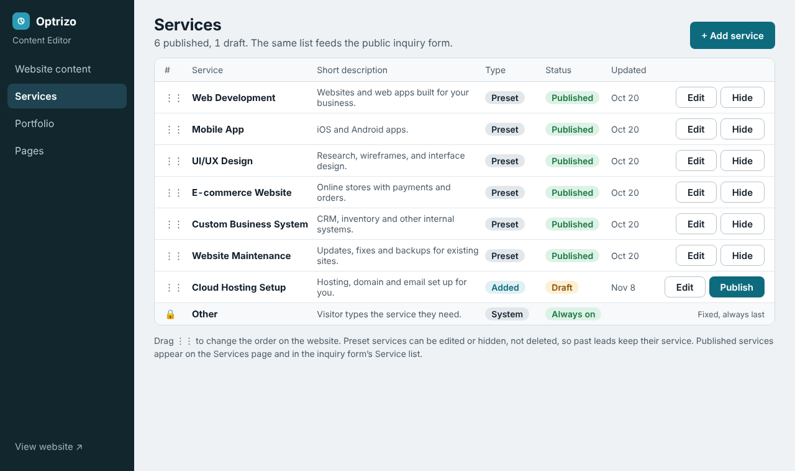

- Screenshot: `03-content-editor/013-c2-content-editor-services-list.png`  ·  HTML: `html/03-content-editor/013-c2-content-editor-services-list.html`
- How you get here: Click Services in the menu

Notes

Where it is
Content Editor section, C2, right of the home board.

What it is
The list of services Optrizo offers. Six are preset (Web Development, Mobile App, UI/UX Design, E-commerce Website, Custom Business System, Website Maintenance), one is a new draft (Cloud Hosting Setup), and “Other” is fixed at the end.

Why it is needed
This answers Sir Ong's comment that services should already be preset, with the CMS only adding or editing them, not fully customizable. It also fixes the short service list in the inquiry form, which had only three options plus Other.

How it works
1. Every published service appears in two places: the Services page and the Service dropdown of the inquiry form (step 1). One list feeds both, so they never disagree.
2. Edit changes the name, description, included items or image.
3. Hide removes a service from the website without deleting it. Preset services cannot be deleted, so old leads and reports still show the service they asked for.
4. Drag ⋮⋮ to change the order.
5. A draft (Cloud Hosting Setup) is visible only here until Publish is clicked.
6. “Other” is locked and always last, so a visitor can always ask for something not listed. Sales sees their typed text on the lead.

### C3 · Content Editor: adds a service

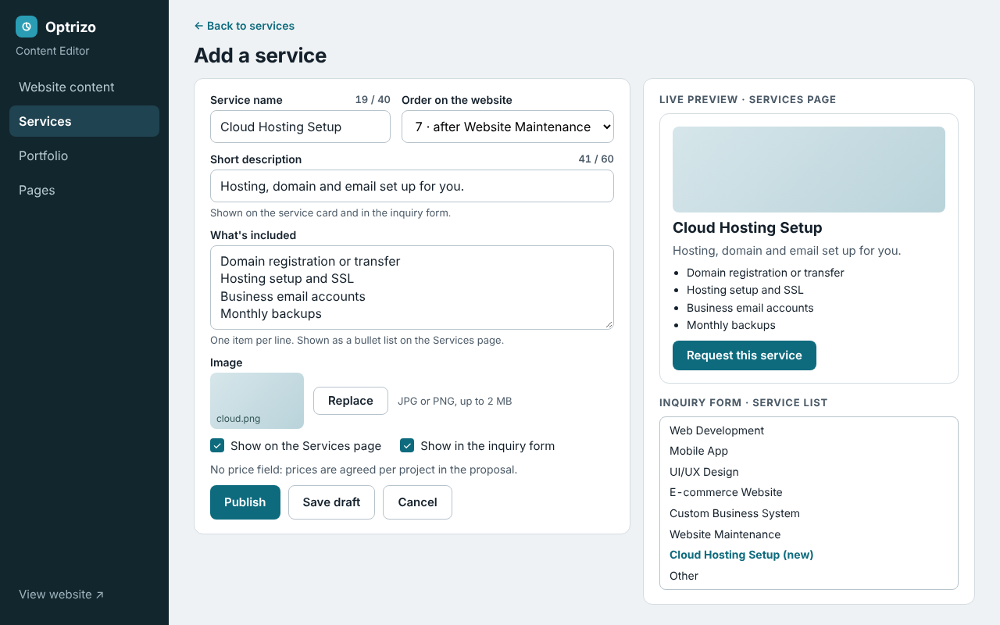

- Screenshot: `03-content-editor/014-c3-content-editor-adds-a-service.png`  ·  HTML: `html/03-content-editor/014-c3-content-editor-adds-a-service.html`
- How you get here: Click + Add service

Notes

Where it is
Content Editor section, C3. Opened from + Add service (C2).

What it is
The form for adding a new service, with a live preview of how it will look on the website and in the inquiry form.

Why it is needed
It shows that the content manager is limited to fixed fields, which keeps the website consistent and keeps the scope small and testable. The live preview means a non-technical editor can check the result before visitors see it.

How it works
1. Fill in the fixed fields: name (max 40 characters), short description (max 60), what's included (one line per item), image (JPG or PNG up to 2 MB) and order on the page.
2. Choose where it appears: the Services page, the inquiry form, or both.
3. There is no price field, on purpose. Prices are agreed per project by the PM in the proposal (steps 10–17).
4. The preview on the right updates as you type: the service card, and the inquiry Service list with the new item marked.
5. Save draft keeps it private. Publish puts it live (C4). Both are recorded in Recent changes and the audit log.
6. Required fields are checked before publishing (empty name, too-long text).

### C4 · Visitor: sees the new service on the website

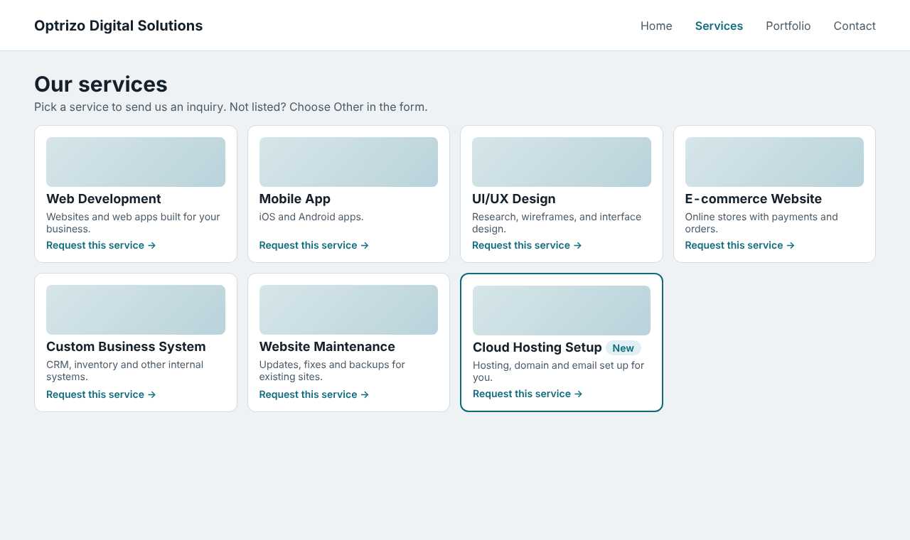

- Screenshot: `03-content-editor/015-c4-visitor-sees-the-new-service-on-the-website.png`  ·  HTML: `html/03-content-editor/015-c4-visitor-sees-the-new-service-on-the-website.html`
- How you get here: After Publish, the website updates

Notes

Where it is
Content Editor section, C4, end of the first row. This is the public website, so there is no sidebar.

What it is
The public Services page after the Content Editor published Cloud Hosting Setup. The new service has a “New” tag.

Why it is needed
It closes the loop: the panel sees the edit (C3) and its effect on the real site (here). It also shows that content management connects to the CRM, because each card leads into the inquiry form, which creates the lead (steps 1–2).

How it works
1. Visitors see every published service in the chosen order. Hidden and draft services do not appear.
2. Request this service opens the inquiry form with that service already picked.
3. The inquiry becomes a New lead in the Sales pipeline automatically (step 2), with the service on the lead card.
4. “Other” is not a card. It is the last option in the form's Service list.

### C5 · Content Editor: portfolio

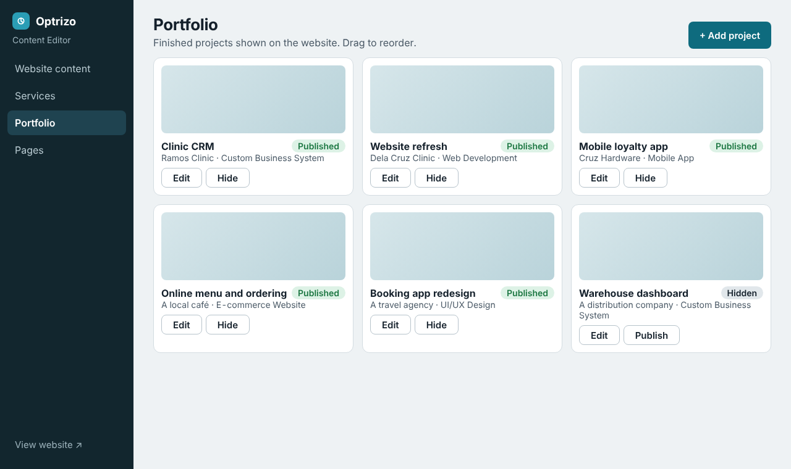

- Screenshot: `03-content-editor/016-c5-content-editor-portfolio.png`  ·  HTML: `html/03-content-editor/016-c5-content-editor-portfolio.html`
- How you get here: Click Portfolio in the menu

Notes

Where it is
Content Editor section, second row, C5.

What it is
The portfolio of finished projects shown on the website: 5 published and 1 hidden.

Why it is needed
The portfolio is the main public proof of Optrizo's work, and it changes often, so non-developers need to be able to update it. It is kept separate from the real project records, so nothing confidential leaks to the website.

How it works
1. Each card shows the image, title, client name (or a general name) and service, plus its status.
2. Edit changes the content, and Hide takes it off the website without deleting it.
3. Drag to reorder, so the best work comes first.
4. + Add project opens the form (C6).
5. The service tag comes from the Services list (C2), so the website can filter the portfolio by service.

### C6 · Content Editor: adds a portfolio project

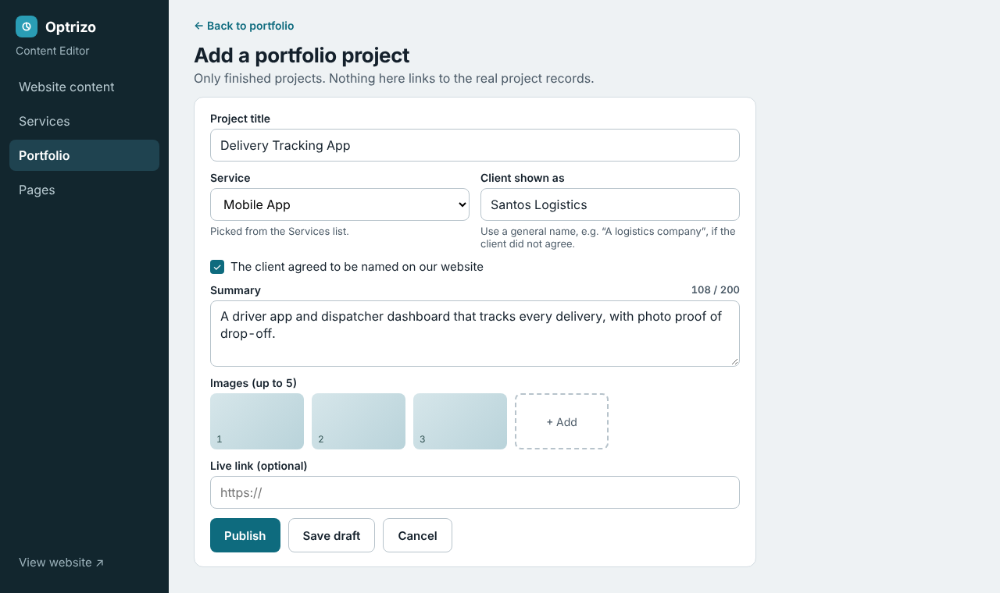

- Screenshot: `03-content-editor/017-c6-content-editor-adds-a-portfolio-project.png`  ·  HTML: `html/03-content-editor/017-c6-content-editor-adds-a-portfolio-project.html`
- How you get here: Click + Add project

Notes

Where it is
Content Editor section, C6. Opened from + Add project (C5).

What it is
The form for adding a finished project to the public portfolio.

Why it is needed
Optrizo works under NDAs (they could not share sample proposals), so client names must only appear with permission. This form makes that rule part of the process instead of leaving it to memory.

How it works
1. Enter the project title and pick the service from the Services list.
2. Client shown as: the real name only if the box “The client agreed to be named on our website” is ticked. Otherwise use a general name like “A logistics company”. Publish is blocked until one of the two is true.
3. Add a summary (max 200 characters), up to 5 images and an optional live link.
4. Save draft or Publish. Nothing here reads from or changes the real project, payments or proposal records.

### C7 · Content Editor: edits the Home page

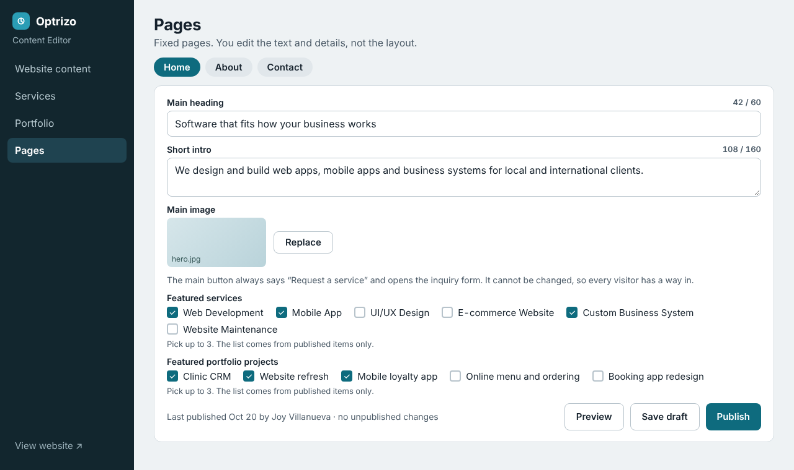

- Screenshot: `03-content-editor/018-c7-content-editor-edits-the-home-page.png`  ·  HTML: `html/03-content-editor/018-c7-content-editor-edits-the-home-page.html`
- How you get here: Click Pages in the menu (opens Home)

Notes

Where it is
Content Editor section, second row, C7. It is the first of the three page editors (C7 Home, C8 About, C9 Contact). Pages in the menu opens on this tab.

What it is
The editor for the website's Home page: main heading, short intro, main image, and which services and portfolio projects are featured.

Why it is needed
The Home page is the first thing a possible client sees, so Optrizo must be able to change its message and highlight its best work without a developer. The page still keeps a fixed layout, which matches the simple-CRUD scope.

How it works
1. Edit the heading (max 60 characters) and intro (max 160). Counters show how much room is left.
2. Replace the main image (JPG or PNG).
3. The “Request a service” button is fixed. It always opens the inquiry form (step 1), so the Home page always leads into the CRM.
4. Featured services: tick up to 3 from the published Services list (C2).
5. Featured portfolio: tick up to 3 from the published portfolio (C5). Hidden or draft items cannot be featured.
6. Preview, Save draft or Publish. The status line shows the last publish and whether there are unpublished changes.

### C8 · Content Editor: edits the About us page

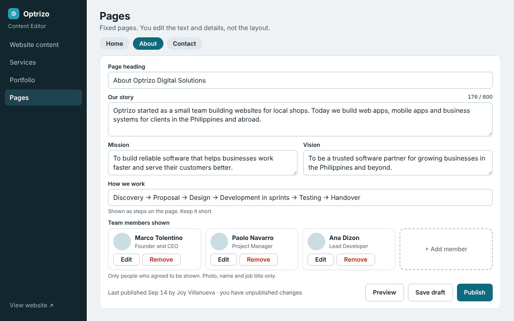

- Screenshot: `03-content-editor/019-c8-content-editor-edits-the-about-us-page.png`  ·  HTML: `html/03-content-editor/019-c8-content-editor-edits-the-about-us-page.html`
- How you get here: Click the About tab

Notes

Where it is
Content Editor section, second row, C8, between the Home (C7) and Contact (C9) editors. Opened with the About tab under Pages.

What it is
The editor for the About us page: heading, company story, mission, vision, how Optrizo works, and the team members shown.

Why it is needed
Possible clients check who they will work with before they send an inquiry. Mission and vision are also standard in Philippine company profiles. Keeping these as fixed fields lets Optrizo update the story or team when people join or leave, without touching code.

How it works
1. Edit the heading, Our story (max 600 characters), Mission and Vision.
2. How we work: one short line, shown as steps on the page. It matches the real process: discovery, proposal, design, development in sprints, testing, handover.
3. Team members: each card has a photo, name and job title only. Edit or Remove a card, or + Add member. Only people who agreed are shown.
4. Team members here are content, not accounts. Adding someone does not create a login. Staff accounts are made only by Super Admin.
5. Preview, Save draft or Publish. Each publish is saved in version history (as on the Contact editor, C9).

### C9 · Content Editor: edits the Contact page

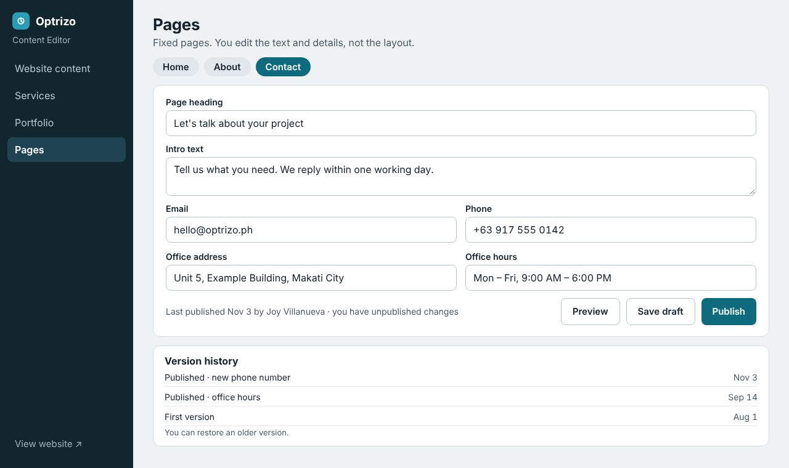

- Screenshot: `03-content-editor/020-c9-content-editor-edits-the-contact-page.png`  ·  HTML: `html/03-content-editor/020-c9-content-editor-edits-the-contact-page.html`
- How you get here: Click the Contact tab

Notes

Where it is
Content Editor section, C9, third row. It is the last of the three page editors (C7 Home, C8 About, C9 Contact).

What it is
Editing the fixed public pages (Home, About, Contact). The example is the Contact page.

Why it is needed
Company details change (phone, address, office hours), and the team must be able to update them without a developer. Keeping the layout fixed means editors change words and details, not design, which is the simple-CRUD scope stated in the paper.

How it works
1. Pick a page tab: Home, About or Contact.
2. Each page has fixed fields. For Contact: heading, intro text, email, phone, office address and office hours.
3. Preview shows the page as visitors will see it.
4. Save draft keeps changes private. Publish puts them live. The status line shows the last publish and whether there are unpublished changes.
5. Version history lists every publish, and an older version can be restored if a mistake goes live.
6. The Contact email and phone here are the same ones shown on the inquiry confirmation (step 1c).

## Sales

### 2 · Sales: the new lead appears (stages move automatically)

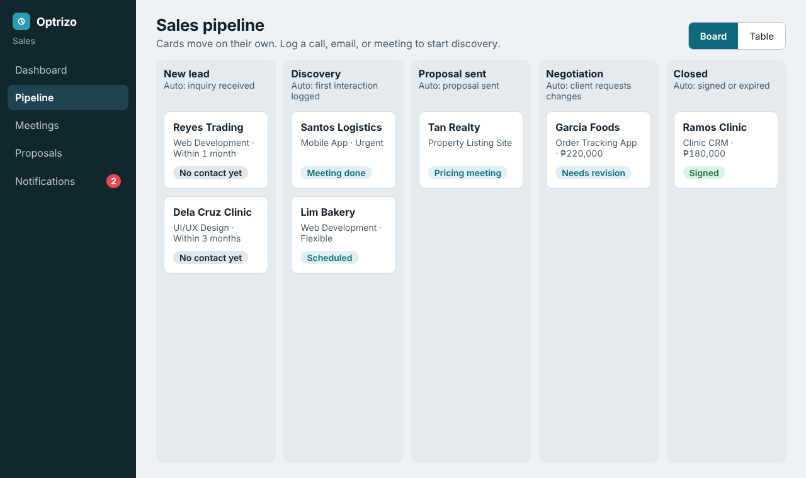

- Screenshot: `04-sales/021-2-sales-the-new-lead-appears-stages-move-automatically.png`  ·  HTML: `html/04-sales/021-2-sales-the-new-lead-appears-stages-move-automatically.html`
- How you get here: Click Pipeline in the menu

Notes

What it is
The sales pipeline board.

How it works
Five stages: New lead, Discovery, Proposal sent, Negotiation, Closed. Cards move by themselves when something happens (inquiry received, first interaction logged, proposal sent, client asks for changes, signed or declined). Sales does not drag cards.

Why it matters
Fixes the panel's concern that pipeline stages did not move automatically.

### 2a · Sales: pipeline as a table

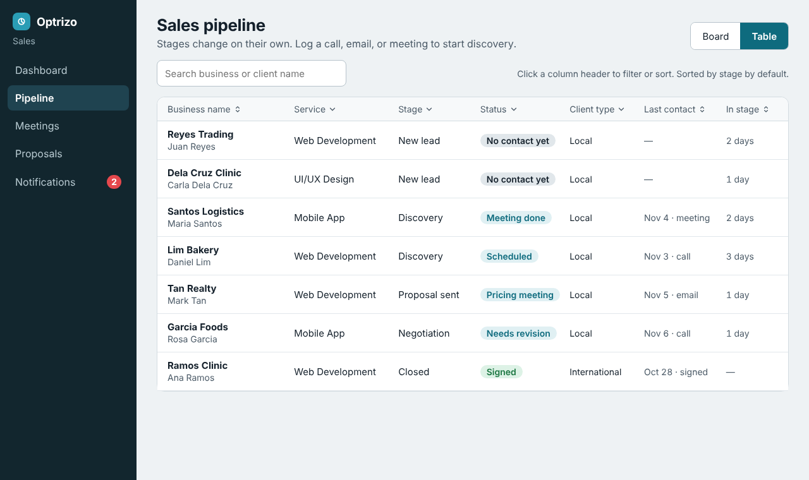

- Screenshot: `04-sales/022-2a-sales-pipeline-as-a-table.png`  ·  HTML: `html/04-sales/022-2a-sales-pipeline-as-a-table.html`
- How you get here: Click Table

Notes

What it is
The same pipeline shown as a table.

How it works
One row per lead with service, stage, status, client type, last contact, and days in the current stage. Search and filter by stage or client type. Stages still change automatically; clicking a row opens the lead.

Why it matters
The board is easy to read with a few leads. The table is faster when there are many: Sales can sort and find stale leads quickly.

### 3 · Sales: opens the new lead

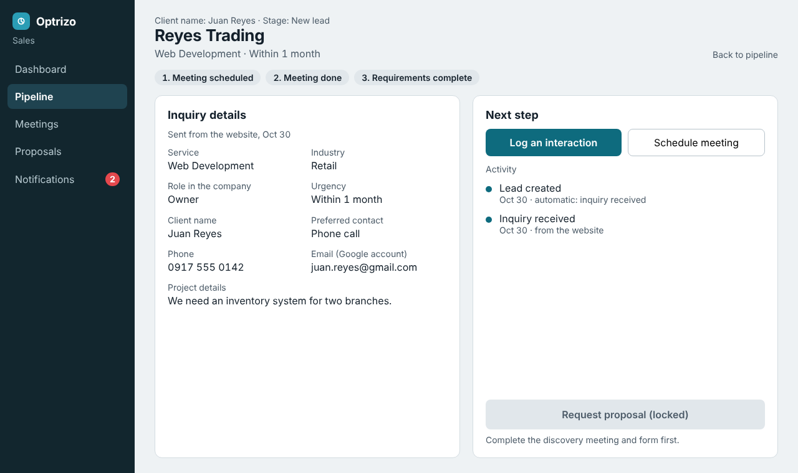

- Screenshot: `04-sales/023-3-sales-opens-the-new-lead.png`  ·  HTML: `html/04-sales/023-3-sales-opens-the-new-lead.html`
- How you get here: Click a lead card (New lead)

Notes

What it is
A new lead opened from the pipeline.

How it works
Shows the inquiry details and a 3-step tracker (meeting scheduled, meeting done, requirements complete). The proposal stays locked.

Why it matters
Shows that a proposal cannot be made straight from an inquiry; discussion comes first.

Details
No budget is asked on the form. It is confirmed after discovery.

Logging the first interaction or scheduling a meeting moves this lead to Discovery automatically.

### 4 · Sales: schedules the discovery meeting (proposal locked)

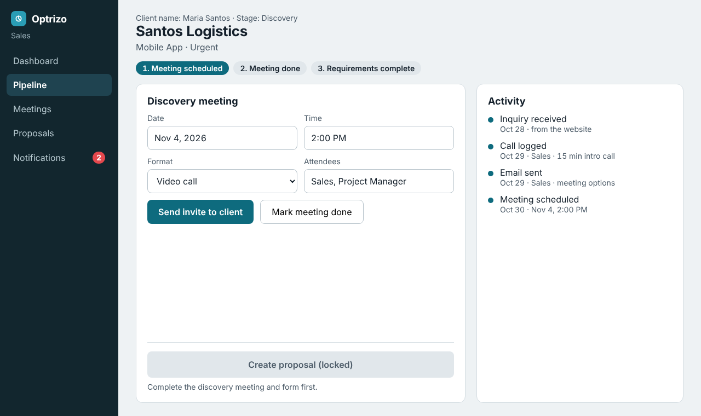

- Screenshot: `04-sales/024-4-sales-schedules-the-discovery-meeting-proposal-locked.png`  ·  HTML: `html/04-sales/024-4-sales-schedules-the-discovery-meeting-proposal-locked.html`
- How you get here: Click Schedule meeting, then send the invite

Notes

What it is
Scheduling the discovery meeting for a lead.

How it works
Sales sets date, time, format and attendees (Sales and PM), then sends the invite. The lead moves to Discovery once the first interaction is logged.

Why it matters
Tracks client appointments, which Ma'am Cecile asked for.

### 4a · Sales: discovery meeting invite

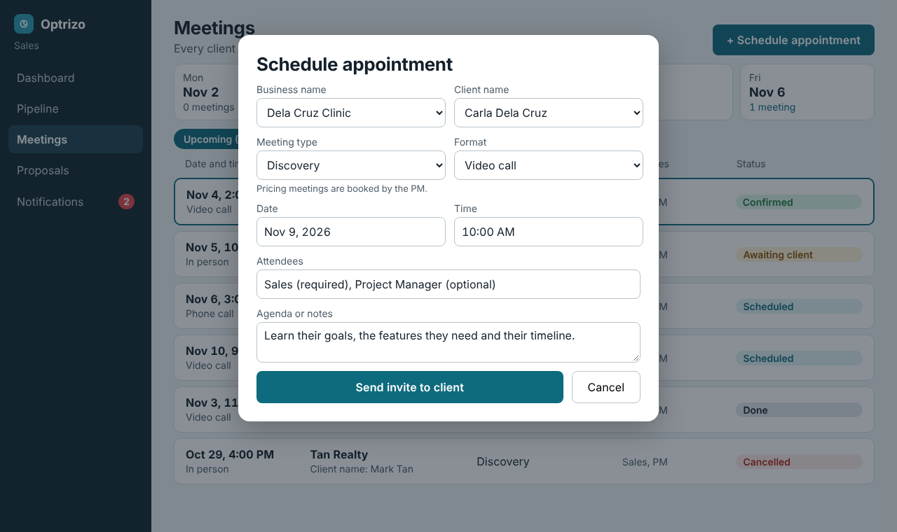

- Screenshot: `04-sales/025-4a-sales-discovery-meeting-invite.png`  ·  HTML: `html/04-sales/025-4a-sales-discovery-meeting-invite.html`
- How you get here: Click + Schedule appointment
- Next: Client confirms in Appointments: step 4c (Client section)

Notes

Where it is
Sales section, Meetings row, right after “Ref · Sales: all appointments”. Main path step 4a.

What it is
The dialog Sales uses to book the discovery meeting with a new lead. This example books Dela Cruz Clinic, a new lead with no contact yet, for Nov 9.

Why it is needed
Ma'am Cecile asked that client management include setting appointments and tracking meetings. It also settles who books which meeting:
• Sales books discovery meetings, because Sales owns the lead.
• The PM books budget and pricing meetings, because the PM owns the proposal and sets the price (Optrizo has no finance department).
Before this change the example showed Sales booking a pricing meeting, which contradicted the PM boards.

How it works
1. Sales opens Meetings and clicks + Schedule appointment (or Schedule meeting on the lead).
2. Business name and client name come from the lead.
3. Meeting type is Discovery. The hint under it says pricing meetings are booked by the PM.
4. Sales picks the format (video, phone, in person), date, time and attendees. Sales is required and the PM is optional, so the PM can hear the requirements first-hand.
5. Send invite to client emails the invite and puts it in the client portal under Appointments (step 4c).
6. The lead stage moves to Discovery automatically, and the system logs it in the activity log.
7. A reminder email goes out one day before.

The list behind the dialog is shared by Sales and the PM, so meetings the PM booked (such as a pricing meeting) also show here, read-only for Sales.

### 4b · Sales: discovery meeting detail

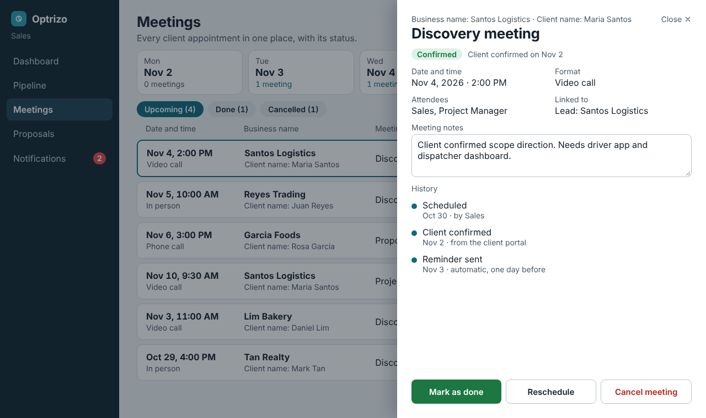

- Screenshot: `04-sales/026-4b-sales-discovery-meeting-detail.png`  ·  HTML: `html/04-sales/026-4b-sales-discovery-meeting-detail.html`
- How you get here: Click a meeting row

Notes

What it is
One meeting's details.

How it works
Shows the agenda, attendees and the client's reply. After the meeting, Sales marks it done and adds notes; a done discovery meeting moves the lead forward.

Why it matters
Meeting outcomes become part of the lead's record.

Details
Marking a discovery meeting done moves the lead forward and opens the discovery form.

### 5 · Sales: discovery meeting done

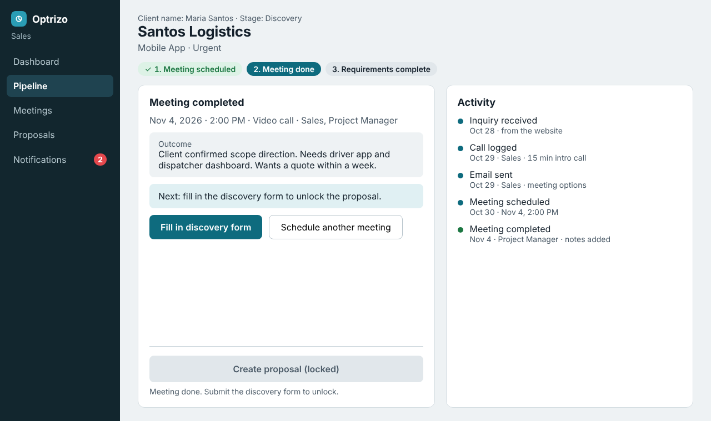

- Screenshot: `04-sales/027-5-sales-discovery-meeting-done.png`  ·  HTML: `html/04-sales/027-5-sales-discovery-meeting-done.html`
- How you get here: Click Mark meeting done

Notes

What it is
The lead after the discovery meeting.

How it works
Sales marks the meeting done and writes the outcome. The next step, the discovery form, unlocks.

Why it matters
Each step leaves a record, so the workflow is clear and traceable.

### 6 · Sales: fills in the discovery form

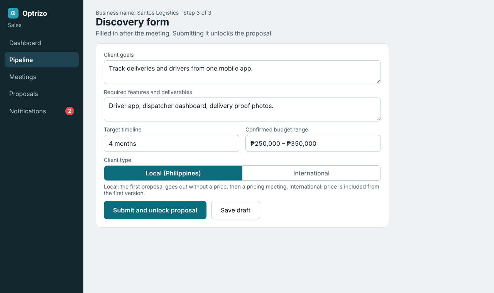

- Screenshot: `04-sales/028-6-sales-fills-in-the-discovery-form.png`  ·  HTML: `html/04-sales/028-6-sales-fills-in-the-discovery-form.html`
- How you get here: Click Fill in discovery form

Notes

What it is
The requirements form filled in after the meeting.

How it works
Records client goals, required features, deliverables and timeline. Submitting it marks requirements complete and unlocks the proposal request.

Why it matters
Gives the PM real requirements to price from, so Sales never guesses deliverables.

Client type (local or international) is set here. It decides whether the first proposal includes a price, and local clients may have lawyers review each version.

### 7 · Sales: requirements complete, proposal unlocked

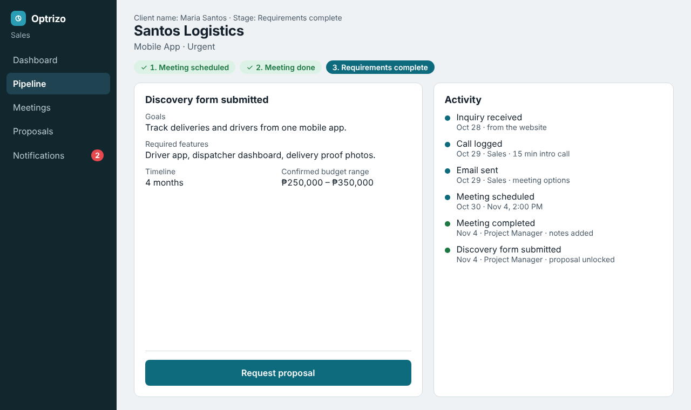

- Screenshot: `04-sales/029-7-sales-requirements-complete-proposal-unlocked.png`  ·  HTML: `html/04-sales/029-7-sales-requirements-complete-proposal-unlocked.html`
- How you get here: Click Submit and unlock proposal

Notes

What it is
The lead with requirements complete.

How it works
Shows the submitted discovery summary and the Request proposal button.

Why it matters
Marks the hand-off point between Sales and the PM.

Details
Requirements are complete. Request the proposal and the Project Manager takes it from here.

Sends a request to the Project Manager, who drafts and prices the proposal.

### 8 · Sales: asks the PM for a proposal

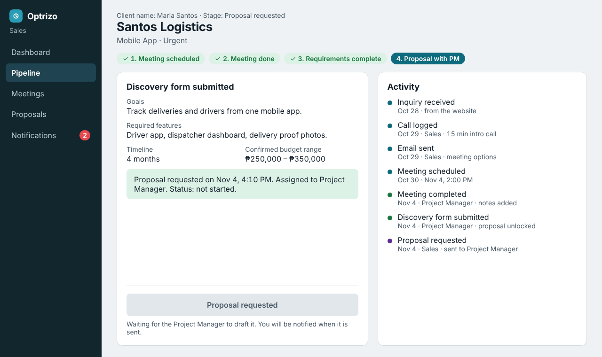

- Screenshot: `04-sales/030-8-sales-asks-the-pm-for-a-proposal.png`  ·  HTML: `html/04-sales/030-8-sales-asks-the-pm-for-a-proposal.html`
- How you get here: Click Request proposal
- Next: Request goes to the PM (Proposals)

Notes

What it is
The lead after the proposal is requested.

How it works
The request and discovery notes go to the PM's Proposals page. Sales waits; the tracker shows 'Proposal with PM'.

Why it matters
The PM, not Sales, writes and prices the proposal, as the panel and Optrizo said.

### 18j · Sales (other path): lead closed lost (automatic)

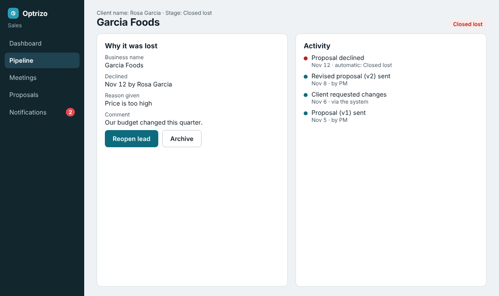

- Screenshot: `04-sales/031-18j-sales-other-path-lead-closed-lost-automatic.png`  ·  HTML: `html/04-sales/031-18j-sales-other-path-lead-closed-lost-automatic.html`
- How you get here: When the client declines (Closed lost)

Notes

What it is
A lead closed as lost.

How it works
Set automatically when the client declines. Shows the reason and comment the client gave. Sales can reopen it later as a new process.

Why it matters
The decline reason helps Optrizo learn why deals are lost.

Details
Reopening starts a new proposal. The earlier versions stay saved.

### 20a · Sales: lead closed won (automatic)

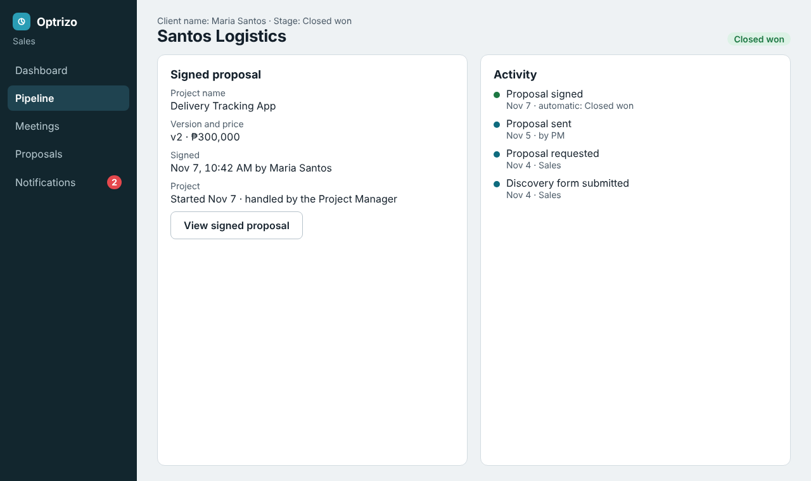

- Screenshot: `04-sales/032-20a-sales-lead-closed-won-automatic.png`  ·  HTML: `html/04-sales/032-20a-sales-lead-closed-won-automatic.html`
- How you get here: When the client signs (Closed won)

Notes

What it is
A lead closed as won.

How it works
Set automatically when the client signs. Shows the signed version, price, date, and a link to the project.

Why it matters
Sales sees the result without asking the PM.

Details
The project was created automatically. The PM now manages it, and this lead is read-only.

### Ref · Sales: dashboard

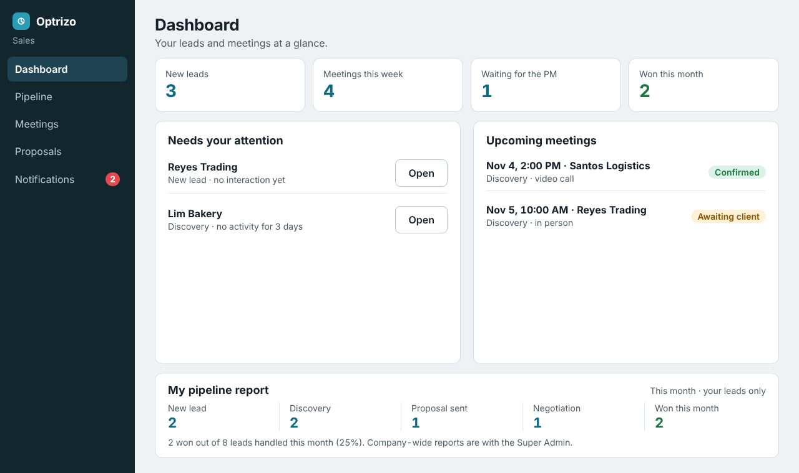

- Screenshot: `04-sales/033-ref-sales-dashboard.png`  ·  HTML: `html/04-sales/033-ref-sales-dashboard.html`

Notes

What it is
Sales' home page.

How it works
Counts of new leads, meetings this week, leads waiting for the PM, and wins this month, plus a list of leads that need attention (for example, no contact yet).

Why it matters
Sales sees what to do today without opening every lead.

### Ref · Sales: empty pipeline

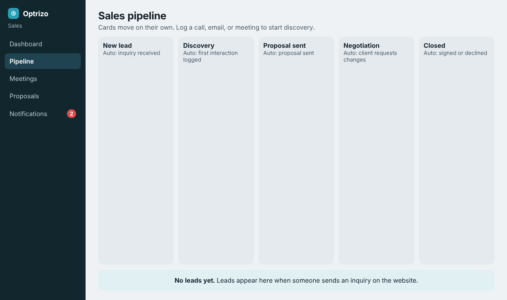

- Screenshot: `04-sales/034-ref-sales-empty-pipeline.png`  ·  HTML: `html/04-sales/034-ref-sales-empty-pipeline.html`
- How you get here: What the pipeline shows when there are no leads

Notes

What it is
The pipeline when there are no leads yet.

How it works
Shows the empty columns with what moves cards into each stage.

Why it matters
First-time users still understand how the board works.

### Ref · Sales: lead activity log

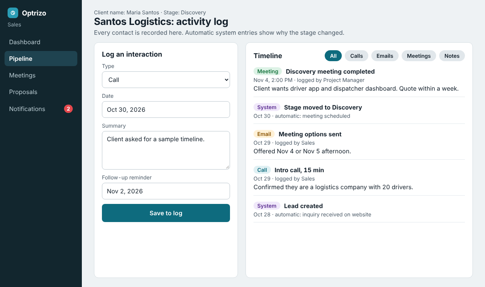

- Screenshot: `04-sales/035-ref-sales-lead-activity-log.png`  ·  HTML: `html/04-sales/035-ref-sales-lead-activity-log.html`
- How you get here: Click Activity on any lead

Notes

What it is
The full contact history of one lead.

How it works
Sales logs calls, emails and meetings with date and summary. System entries explain each automatic stage change.

Why it matters
Answers the panel's concern that there was no way to log client interactions before the proposal.

### Ref · Sales: all appointments

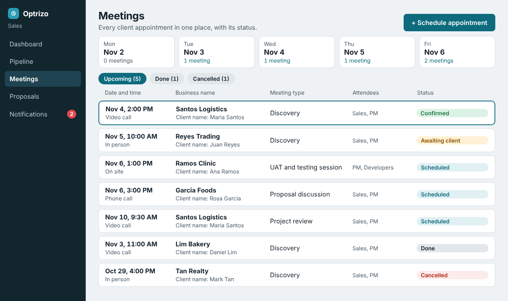

- Screenshot: `04-sales/036-ref-sales-all-appointments.png`  ·  HTML: `html/04-sales/036-ref-sales-all-appointments.html`

Notes

What it is
All client appointments in one list.

How it works
A week strip with meeting counts, filters (Upcoming, Done, Cancelled), and rows with date, business, meeting type, attendees and status.

Why it matters
Ma'am Cecile asked for setting appointments and tracking client meetings.

Meeting types: Discovery, Budget and pricing, Proposal discussion, Project review, and UAT and testing session (the client tests on the agreed date).

### Ref · Sales: notifications

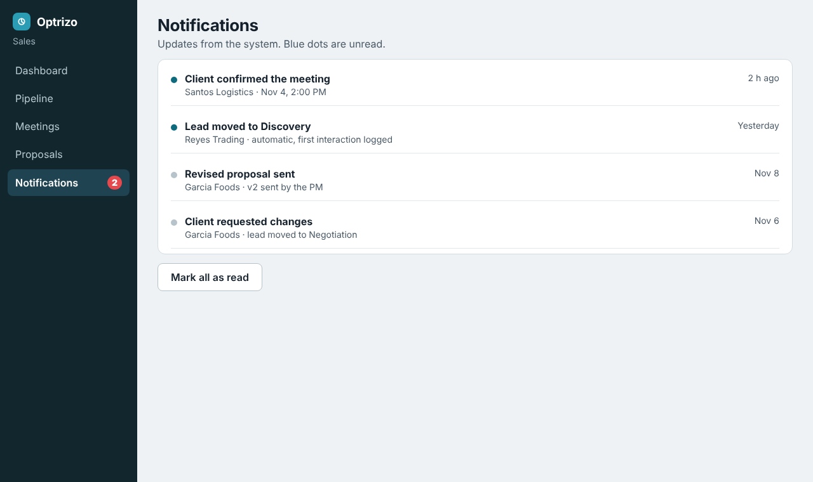

- Screenshot: `04-sales/037-ref-sales-notifications.png`  ·  HTML: `html/04-sales/037-ref-sales-notifications.html`
- How you get here: Click Notifications in the menu

Notes

What it is
Sales' notifications.

How it works
System updates such as client confirmed a meeting, lead moved stage, proposal signed. Unread items have a blue dot.

Why it matters
Sales hears about changes without checking every screen.

### Ref · Sales: proposals (view only)

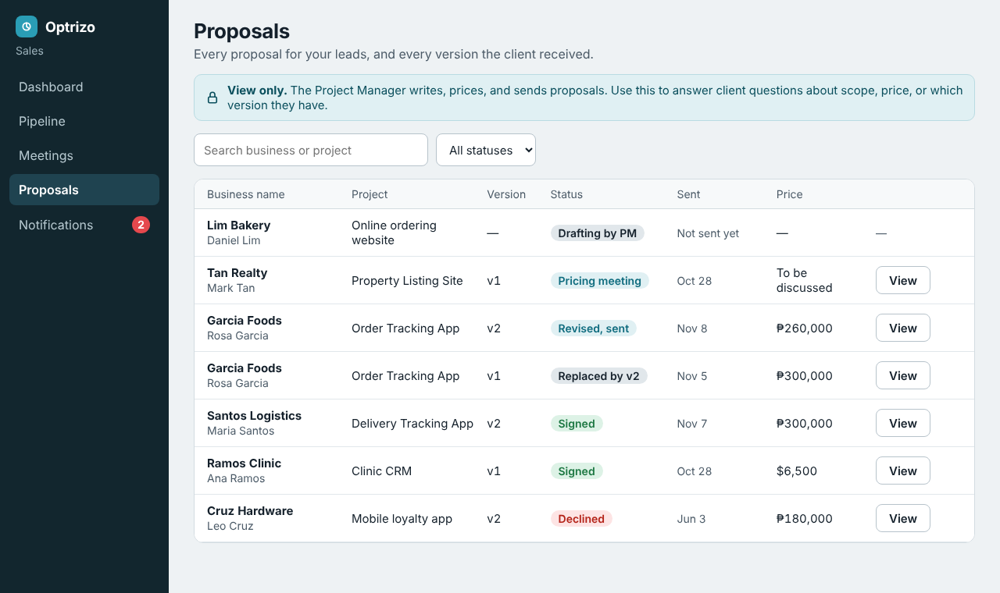

- Screenshot: `04-sales/038-ref-sales-proposals-view-only.png`  ·  HTML: `html/04-sales/038-ref-sales-proposals-view-only.html`
- How you get here: Click Proposals in the menu

Notes

What it is
A read-only list of every proposal for Sales' leads, including each version sent.

How it works
Shows project, version, status, date sent, and price. View opens the same document the client received. There are no edit or send buttons; the PM owns scope, price, and timeline.

Why it matters
Sales handles the client relationship, so they need to see exactly what the client was sent when the client calls with a question.

## Project Manager

### 9 · PM: proposal request arrives

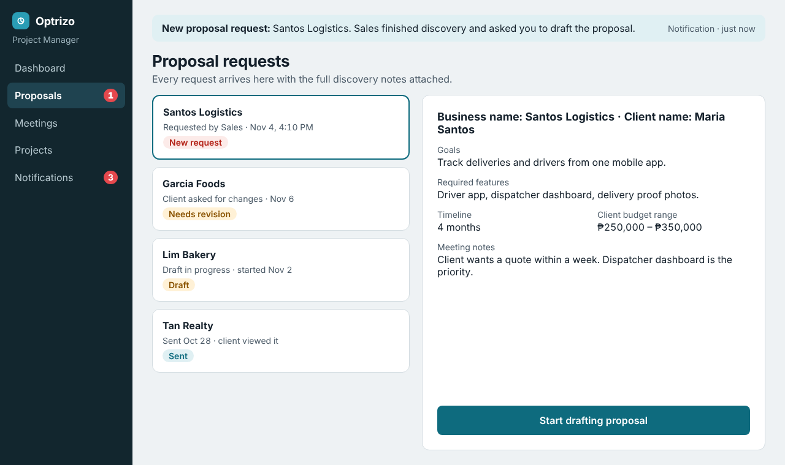

- Screenshot: `05-project-manager/039-9-pm-proposal-request-arrives.png`  ·  HTML: `html/05-project-manager/039-9-pm-proposal-request-arrives.html`
- How you get here: Click Proposals in the menu

Notes

What it is
The PM's proposal list.

How it works
Every request from Sales arrives here with the discovery notes. Each row shows its state: New request, Draft, Sent, Needs revision.

Why it matters
The PM sees which proposals to write next and which need changes.

### 10 · PM: drafts proposal v1 (price to be discussed)

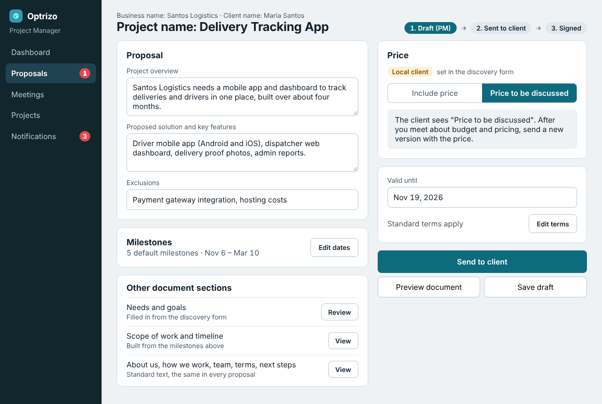

- Screenshot: `05-project-manager/040-10-pm-drafts-proposal-v1-price-to-be-discussed.png`  ·  HTML: `html/05-project-manager/040-10-pm-drafts-proposal-v1-price-to-be-discussed.html`
- How you get here: Click Start drafting proposal
- Next: v1 goes to the client: step 11 (Client section)

Notes

What it is
The PM drafts the proposal.

How it works
Fill in overview, scope and exclusions. Milestones are the 5 defaults; only dates can change. Price can be included or set to 'Price to be discussed' for the first version. Then Send to client.

Why it matters
Matches Optrizo's real process: first proposal without price, then a pricing meeting. Fixed milestones answer the panel.

Details
Default milestones are fixed. You can set dates only.

First version can go out without a price. After the pricing meeting, send a new version with the price. Currency cannot change after sending.

Local clients usually have lawyers review each version. Log that outside the system. International clients follow the same steps without it.

### 10a · PM: reviews needs and goals

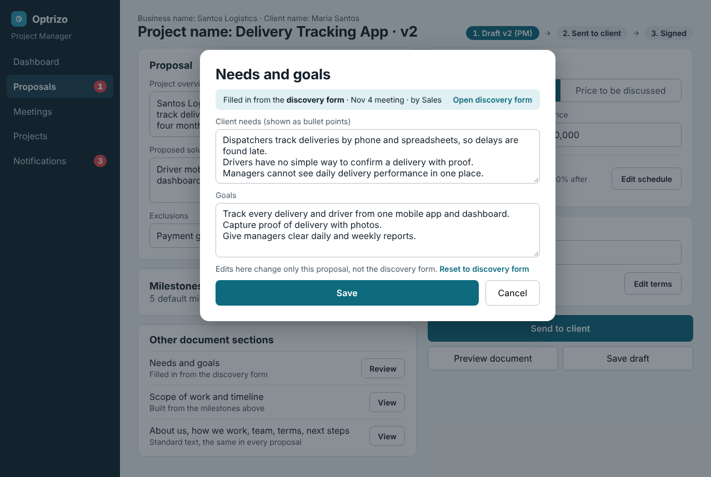

- Screenshot: `05-project-manager/041-10a-pm-reviews-needs-and-goals.png`  ·  HTML: `html/05-project-manager/041-10a-pm-reviews-needs-and-goals.html`
- How you get here: Click Review (Needs and goals)

Notes

What it is
The needs and goals section of the proposal.

How it works
It is filled in automatically from the discovery form Sales submitted after the meeting. The PM can reword it for this proposal; the discovery form itself does not change. Reset brings back the original text.

Why it matters
Shows that the proposal is based on the discovery meeting, which the panel asked for before any proposal is made.

### 10b · PM: views scope and timeline

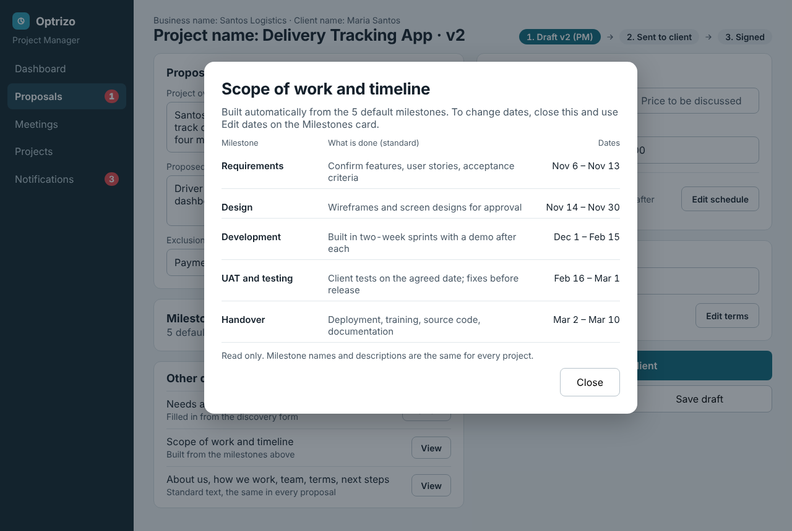

- Screenshot: `05-project-manager/042-10b-pm-views-scope-and-timeline.png`  ·  HTML: `html/05-project-manager/042-10b-pm-views-scope-and-timeline.html`
- How you get here: Click View (Scope of work and timeline)

Notes

What it is
A read-only view of the scope of work and timeline section.

How it works
Built from the 5 default milestones: each has a standard description and the dates the PM set. Dates are changed with Edit dates on the Milestones card.

Why it matters
Milestones stay fixed and consistent across projects, so the PM never retypes the scope by phase.

### 10c · PM: views standard sections

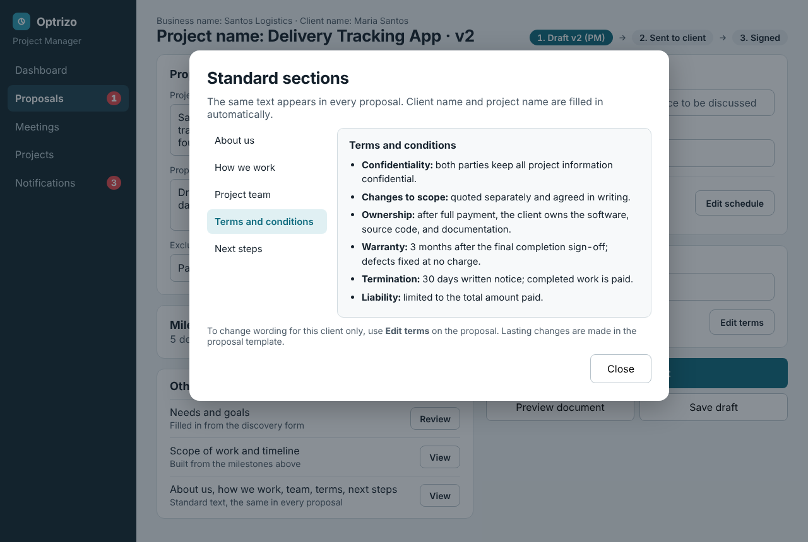

- Screenshot: `05-project-manager/043-10c-pm-views-standard-sections.png`  ·  HTML: `html/05-project-manager/043-10c-pm-views-standard-sections.html`
- How you get here: Click View (standard sections)

Notes

What it is
The standard sections that appear in every proposal: About us, how we work, team, terms, next steps.

How it works
Read-only here. Client and project names fill in automatically. Edit terms on the proposal changes wording for this client only.

Why it matters
The PM writes only what is unique to each client, which keeps proposals consistent and quick to prepare.

### 10d · PM: previews v1, then sends it

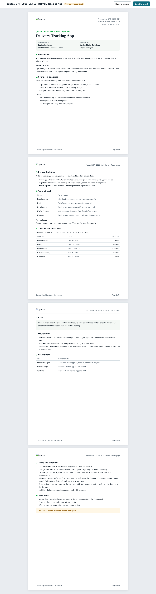

- Screenshot: `05-project-manager/044-10d-pm-previews-v1-then-sends-it.png`  ·  HTML: `html/05-project-manager/044-10d-pm-previews-v1-then-sends-it.html`
- How you get here: Click Preview document (price to be discussed)

Notes

What it is
The 4-page document preview of the first proposal, before it is sent.

How it works
Sections: introduction and About Optrizo, client needs and goals (from the discovery form), proposed solution, scope, timeline, price, how we work, team, terms, next steps. Section 6 says the price is to be discussed. There are no signature lines.

Why it matters
The PM checks exactly what the client will read. Structure follows common industry proposal templates, since Optrizo's real proposals are under NDA.

### 12 · PM: pricing meeting request arrives (notification)

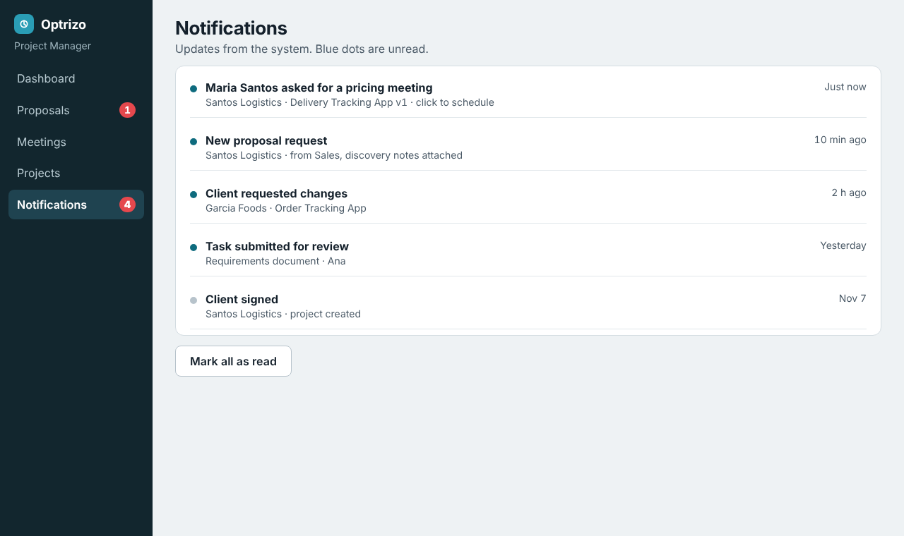

- Screenshot: `05-project-manager/045-12-pm-pricing-meeting-request-arrives-notification.png`  ·  HTML: `html/05-project-manager/045-12-pm-pricing-meeting-request-arrives-notification.html`
- How you get here: PM clicks Notifications (red badge shows 4)

Notes

Where it is
PM section, in the pricing meeting rows placed between proposal v1 (step 10) and proposal v2 (step 17). Main path step 12.

What it is
The PM's notification list. The new item at the top reads “Maria Santos asked for a pricing meeting”, and the menu badge shows 4.

Why it is needed
Hand-offs between roles must be visible without anyone checking by hand. When the client asks for a pricing meeting (step 11), the PM learns about it here and from the red badge. That is clearer than a banner on the Meetings page, which is what we removed.

How it works
1. The client clicks Request pricing meeting (step 11).
2. The system creates this notification and adds 1 to the Notifications badge.
3. The PM clicks it. The Schedule pricing meeting form opens with the client and proposal already filled in (step 13).
4. After it is opened, the notification shows as read (grey dot).

### 13 · PM: schedules the pricing meeting

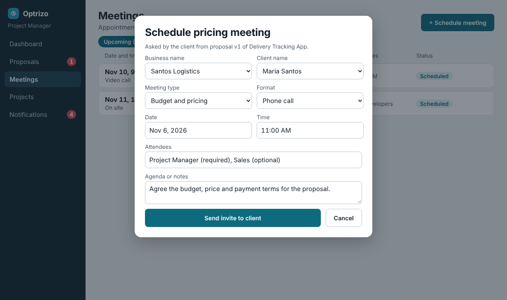

- Screenshot: `05-project-manager/046-13-pm-schedules-the-pricing-meeting.png`  ·  HTML: `html/05-project-manager/046-13-pm-schedules-the-pricing-meeting.html`
- How you get here: Click the pricing meeting notification (or + Schedule meeting)
- Next: Invite goes to the client: step 14 (Client section)

Notes

Where it is
PM section, pricing meeting row, to the right of Notifications. Main path step 13.

What it is
The form the PM uses to book the Budget and pricing meeting the client asked for.

Why it is needed
Optrizo prices proposals in a meeting, not on paper, and the PM sets the price. So the PM owns this meeting. Booking it in the system records the date, keeps both sides reminded, and links the meeting to the proposal.

How it works
1. Opened from the notification (step 12) or from Meetings → + Schedule meeting.
2. Business, client and meeting type (Budget and pricing) are filled in. The subtitle names the proposal it came from.
3. The PM picks the format, date and time. Attendees: the PM is required and Sales is optional.
4. Agenda: agree the budget, price and payment terms.
5. Send invite to client puts the invite in the client's Appointments (step 14) and emails it.
6. The meeting appears in both the PM's and Sales' meeting lists.

### 15 · PM: runs the pricing meeting, marks it done

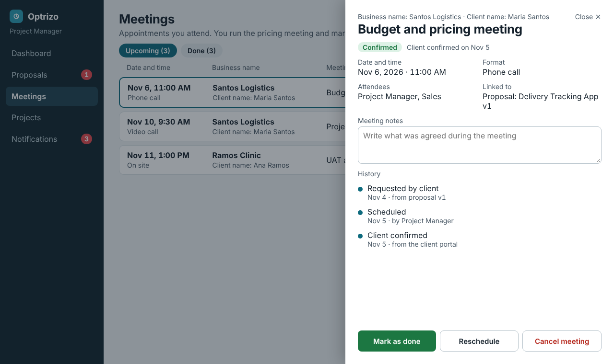

- Screenshot: `05-project-manager/047-15-pm-runs-the-pricing-meeting-marks-it-done.png`  ·  HTML: `html/05-project-manager/047-15-pm-runs-the-pricing-meeting-marks-it-done.html`
- How you get here: Click the meeting in the list

Notes

Where it is
PM section, pricing meeting row, the right-most board. Main path step 15.

What it is
The meeting panel after the client confirmed. The PM uses it during and after the call.

Why it is needed
It records what was agreed. The notes become part of the history the PM uses to write v2, and Super Admin can see the event in the audit log.

How it works
1. The PM opens the meeting from Meetings or the dashboard.
2. Details: date, format, attendees, and the proposal it is linked to (Delivery Tracking App v1).
3. History shows each step: requested by client (Nov 4), scheduled by PM (Nov 5), confirmed by client (Nov 5).
4. During or after the call the PM writes the agreed points in Meeting notes.
5. Mark as done closes the meeting (step 16). Reschedule and Cancel meeting notify the client.

### 16 · PM: meeting done, next step is the price

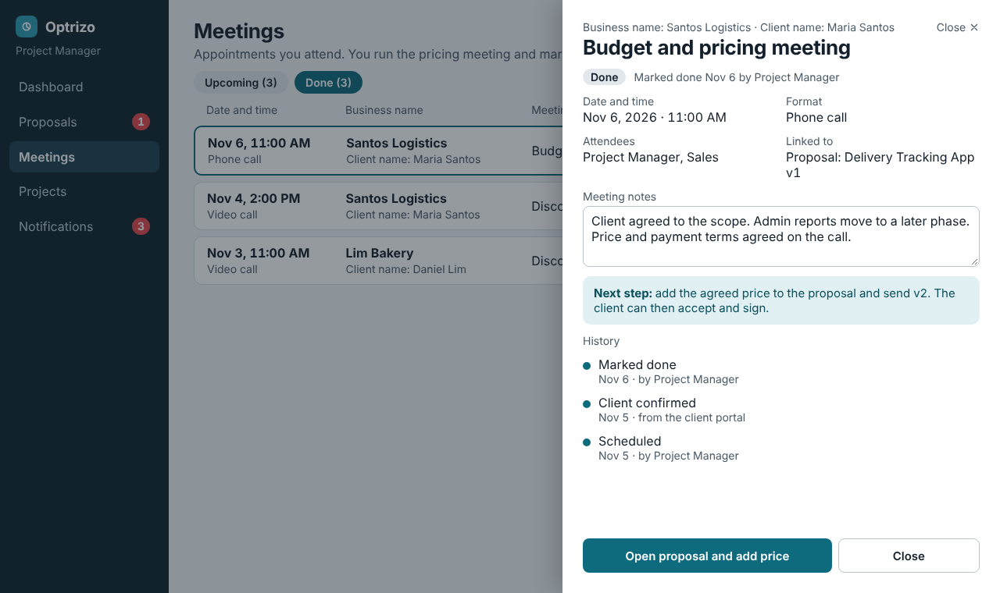

- Screenshot: `05-project-manager/048-16-pm-meeting-done-next-step-is-the-price.png`  ·  HTML: `html/05-project-manager/048-16-pm-meeting-done-next-step-is-the-price.html`
- How you get here: Click Mark as done
- Next: Next: step 17, proposal v2 with the price (two rows down)

Notes

Where it is
PM section, second pricing meeting row, under Notifications. Main path step 16. The next step (17, proposal v2 with the price) is two rows below.

What it is
The same panel after Mark as done. The status is Done and the notes are saved.

Why it is needed
It moves the PM straight on to the next action, so the deal does not stall after the meeting.

How it works
1. The status changes to Done, and the history adds “Marked done · by Project Manager”.
2. The teal Next step box says: add the agreed price to the proposal and send v2.
3. Open proposal and add price opens the proposal with Include price selected (step 17).
4. The PM enters the currency, total and payment schedule (17a), previews (17b) and sends. The client can then Accept and sign (19).

### 17 · PM: proposal v2 with the agreed price

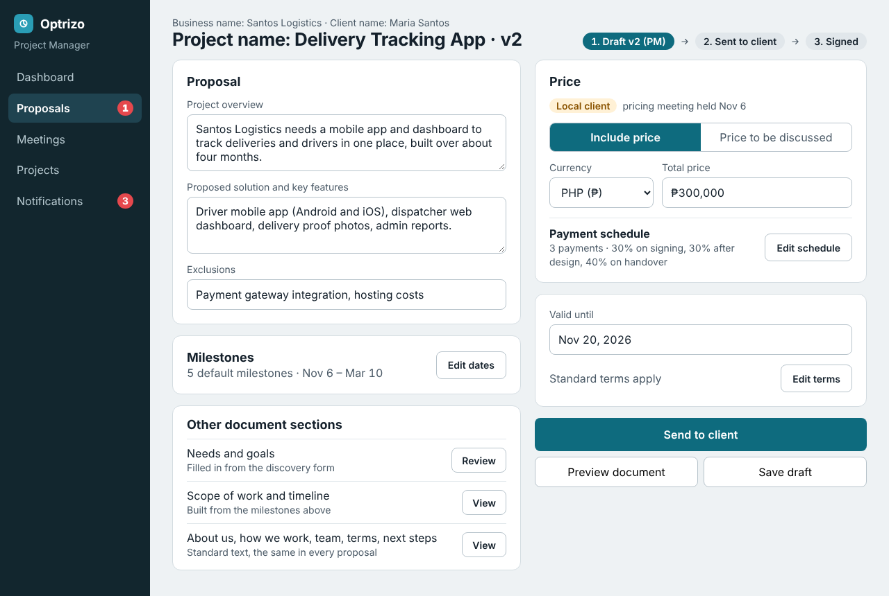

- Screenshot: `05-project-manager/049-17-pm-proposal-v2-with-the-agreed-price.png`  ·  HTML: `html/05-project-manager/049-17-pm-proposal-v2-with-the-agreed-price.html`
- How you get here: After the pricing meeting (or for international clients)

Notes

What it is
The same proposal screen with Include price selected.

How it works
The PM enters currency and total price. The payment schedule shows as one summary line (default 30/30/40); Edit schedule opens the full list of payments. Sending this version lets the client Accept and sign.

Why it matters
Local clients get this after the Budget and pricing meeting. International clients get the price in the first version, so the PM picks Include price from the start.

### 17a · PM: edits the payment schedule

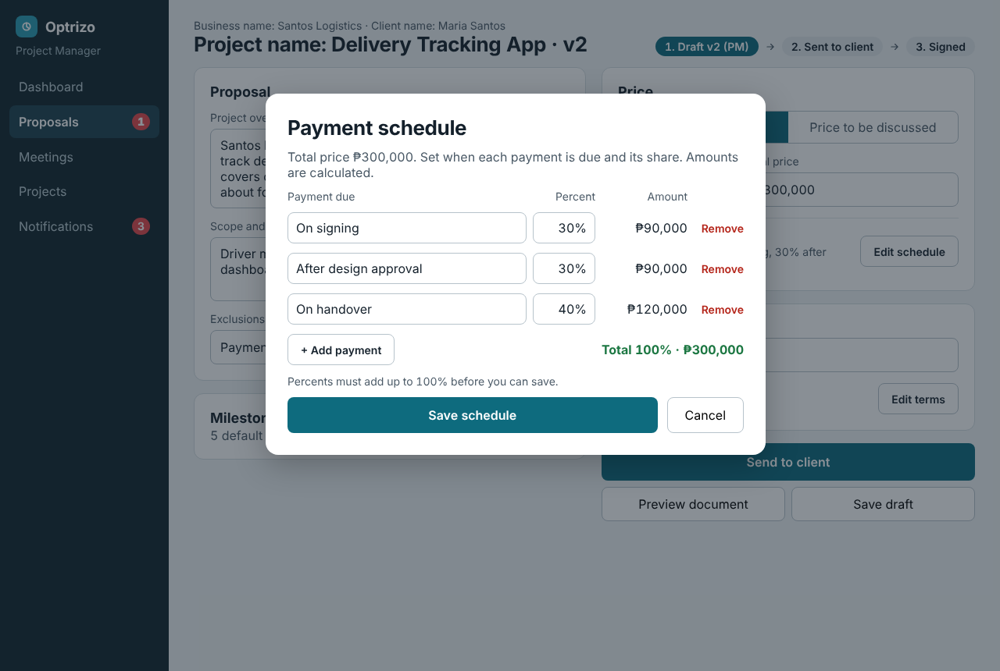

- Screenshot: `05-project-manager/050-17a-pm-edits-the-payment-schedule.png`  ·  HTML: `html/05-project-manager/050-17a-pm-edits-the-payment-schedule.html`
- How you get here: Click Edit schedule

Notes

What it is
The payment schedule editor for a priced proposal.

How it works
Each row is one payment: when it is due and its percent. Amounts are calculated from the total price. The PM can add or remove payments. Save works only when the percents add up to 100%.

Why it matters
Keeps the proposal screen short while still letting the PM match the payment terms agreed in the pricing meeting. The client sees the schedule on the proposal and in the PDF.

### 17b · PM: previews v2, then sends it

- Screenshot: `05-project-manager/051-17b-pm-previews-v2-then-sends-it.png`  ·  HTML: `html/05-project-manager/051-17b-pm-previews-v2-then-sends-it.html`
- How you get here: Click Preview document (priced version)

Notes

What it is
The 4-page document preview of the priced proposal (v2), before it is sent.

How it works
Same sections as v1, but section 6 has the payment schedule and total, and section 11 has empty signature lines. They fill in when the client signs online or the PM records a paper signature.

Why it matters
This is the version the client signs and that lawyers review for local clients. Terms include the 3-month warranty Optrizo gives when the client does not take a support retainer.

### 18d · PM (other path): reviews the change request

- Screenshot: `05-project-manager/052-18d-pm-other-path-reviews-the-change-request.png`  ·  HTML: `html/05-project-manager/052-18d-pm-other-path-reviews-the-change-request.html`
- How you get here: If the client clicks Request changes (Client section)

Notes

What it is
The proposal after the client asks for changes.

How it works
The lead moves to Negotiation automatically. Left: the conversation (client messages, attached files, logged calls). Right: edit the next version (v2).

Why it matters
All negotiation stays tied to the proposal, in the system or logged from outside.

Details
Milestones stay at the five defaults. You can change dates only. v1 stays saved.

Clients can write here, and you can also log talks that happen by phone, email, or chat.

### 18e · PM (other path): replies in the system

- Screenshot: `05-project-manager/053-18e-pm-other-path-replies-in-the-system.png`  ·  HTML: `html/05-project-manager/053-18e-pm-other-path-replies-in-the-system.html`
- How you get here: Click Reply in system

Notes

What it is
The PM replies to the client in the system.

How it works
The reply is saved on the proposal and shown on the client's portal; it can also be sent as an email.

Why it matters
Keeps a written record of what was agreed.

Details
Milestones stay at the five defaults. You can change dates only. v1 stays saved.

Clients can write here, and you can also log talks that happen by phone, email, or chat.

The client sees your reply in their portal under this proposal. It is saved in the negotiation thread and the activity log.

### 18f · PM (other path): logs a talk held outside (e.g. lawyer)

- Screenshot: `05-project-manager/054-18f-pm-other-path-logs-a-talk-held-outside-e-g-lawyer.png`  ·  HTML: `html/05-project-manager/054-18f-pm-other-path-logs-a-talk-held-outside-e-g-lawyer.html`
- How you get here: Click Log a discussion held outside

Notes

What it is
Log a discussion held outside the system.

How it works
The PM records a call, email or in-person meeting (for example, a lawyer review) with a date and summary. It appears in the proposal history and the Sales activity log.

Why it matters
Many local clients negotiate by phone or through lawyers; this keeps those talks on record.

Details
Milestones stay at the five defaults. You can change dates only. v1 stays saved.

Clients can write here, and you can also log talks that happen by phone, email, or chat.

Saved to the negotiation thread and the activity log as “logged by PM, held outside the system”. The client does not see it unless you tick the box.

### 18g · PM (other path): sends revised v2

- Screenshot: `05-project-manager/055-18g-pm-other-path-sends-revised-v2.png`  ·  HTML: `html/05-project-manager/055-18g-pm-other-path-sends-revised-v2.html`
- How you get here: Click Send revised proposal (v2)

Notes

What it is
The proposal after the revised version is sent.

How it works
Version history lists each version with timeline and price. 'What changed' compares v2 with v1.

Why it matters
Both sides can see exactly what changed between versions.

Details
Waiting for the client. The lead stays in Negotiation until they sign or decline.

What happens next
1. The client gets an email and sees v2 in their portal, with the changes listed.
2. They can sign, ask for more changes, or decline.
3. If they sign: Closed Won, and the project is created.
4. If they ask again: a new version (v3) starts, and v2 is kept.
5. If they decline: Closed Lost.
Every version and every message stays in the lead’s activity log.

### 19a · PM (other path): records a paper signature

- Screenshot: `05-project-manager/056-19a-pm-other-path-records-a-paper-signature.png`  ·  HTML: `html/05-project-manager/056-19a-pm-other-path-records-a-paper-signature.html`
- How you get here: Client signed on paper

Notes

What it is
Record a paper signature.

How it works
For clients who sign a printed copy (often local clients), the PM uploads the scan, enters who signed and when, and confirms it matches the version. Saving marks the proposal Signed.

Why it matters
Paper and online signing lead to the same result, so the flow doesn't break.

Details
For clients who sign on paper, mostly local clients.

Lawyer review happens outside the system. Log it with "Log a discussion held outside".

Saving marks the proposal Signed, same as an online signature. The scan is kept as the signed copy.

### 21 · PM: the new project in the projects list

- Screenshot: `05-project-manager/057-21-pm-the-new-project-in-the-projects-list.png`  ·  HTML: `html/05-project-manager/057-21-pm-the-new-project-in-the-projects-list.html`
- How you get here: After the client signs, click Projects

Notes

What it is
The PM's project list.

How it works
Projects are created automatically when a client signs. Filters: All, Active, Completed.

Why it matters
No manual project setup; the signed proposal starts the project.

### 22 · PM: project board

- Screenshot: `05-project-manager/058-22-pm-project-board.png`  ·  HTML: `html/05-project-manager/058-22-pm-project-board.html`
- How you get here: Click a project
- Next: Tasks appear in the developer’s My tasks

Notes

What it is
The project board.

How it works
Milestone strip on top (5 fixed milestones). Task columns: To do, In progress, In review, Done. Each column says what moves a task into it.

Why it matters
Task status changes by actions, not by dragging, which the panel asked for.

Details
Milestones are set by default and cannot be edited. The next one opens by itself when every task in the current one is Done.

### 22a · PM: project team

- Screenshot: `05-project-manager/059-22a-pm-project-team.png`  ·  HTML: `html/05-project-manager/059-22a-pm-project-team.html`
- How you get here: Click Team

Notes

What it is
The project team.

How it works
The PM adds or removes developers for this project.

Why it matters
Only assigned developers see the project.

Details
Milestones are set by default and cannot be edited. The next one opens by itself when every task in the current one is Done.

Developers only see the tasks on projects they belong to. Removing a developer reassigns their open tasks to you.

### 22b · PM: adds a task

- Screenshot: `05-project-manager/060-22b-pm-adds-a-task.png`  ·  HTML: `html/05-project-manager/060-22b-pm-adds-a-task.html`
- How you get here: Click + Add task

Notes

What it is
Add a task.

How it works
The PM sets title, milestone, assignee and due date. The developer is notified and the task shows in their My tasks.

Why it matters
Work is split and assigned in one step.

Details
Milestones are set by default and cannot be edited. The next one opens by itself when every task in the current one is Done.

New tasks start in To do. The developer is notified and the milestone progress updates.

During Development the form also has Sprint and Source fields (see PM · Add task to backlog).

### 23 · PM: backlog

- Screenshot: `05-project-manager/061-23-pm-backlog.png`  ·  HTML: `html/05-project-manager/061-23-pm-backlog.html`
- How you get here: Click Backlog (4) on Development sprints

Notes

What it is
The project's backlog: every Development task that exists but is not in a sprint yet. Opened from the Backlog (4) button on the sprint line, next to + Plan sprint.

How it works
• A task lands here when it is created under the Development milestone with Sprint left as "Backlog".
• Sources, shown as a tag on each row: Proposal (deliverables from the signed proposal broken into tasks after Design is approved), Client change (an approved change request), Added by PM (internal work, e.g. a bug fix).
• Filter by source. Sort is highest priority first.
• Each row has Move to: pick an existing planned sprint and the task moves there. Or tick several and click Plan sprint with selected to start a new sprint with them already ticked.
• + Add task opens the Add task form with Milestone set to Development and Sprint set to Backlog.
• The count on the chip updates live (4 now, 5 after Add task, 2 after Sprint 5 is saved).
• Tasks still here when Development ends are flagged to the PM before UAT starts, so nothing promised is silently dropped.

Why it matters
Without it, tasks not in a sprint are invisible: the PM could only see them inside the Plan sprint panel. The backlog is the single to-do list for the whole Development phase. It lets the PM see what is left, what came from the proposal versus later changes, and decide what goes into the next sprint. New requests go here instead of interrupting the current sprint.

### 23a · PM: adds a task to the backlog

- Screenshot: `05-project-manager/062-23a-pm-adds-a-task-to-the-backlog.png`  ·  HTML: `html/05-project-manager/062-23a-pm-adds-a-task-to-the-backlog.html`
- How you get here: Click + Add task (on Backlog)

Notes

What it is
The same Add task form as before, opened during Development (here from the Backlog). It gains two fields: Sprint and Source.

How it works
• Milestone is fixed to Development because the project is in that phase.
• Sprint: defaults to "Backlog (no sprint yet)". The PM can also drop it into the current or a planned sprint. If a sprint is picked, the task's due date is that sprint's end date. The Sprint field only appears for Development tasks.
• Source: Proposal scope, Client change request or Added by PM. With Client change, the PM links the approved change request (CR-03), so the task can be traced back to what the client asked for.
• Example: at the Sprint 2 demo the client asked for a customer signature on delivery. The PM approves it as CR-03 and adds it here. It goes to the backlog, not into Sprint 2, so the current sprint is not disrupted.
• Add to backlog saves it. The Backlog count goes from 4 to 5, and the task appears in the Plan sprint list.

Why it matters
It answers "how does a task get into the backlog?" and keeps every task traceable to its origin. That matters for scope control: client changes are visible and separate from what the proposal priced.

### 23b · PM: plans a sprint

- Screenshot: `05-project-manager/063-23b-pm-plans-a-sprint.png`  ·  HTML: `html/05-project-manager/063-23b-pm-plans-a-sprint.html`
- How you get here: Click Plan sprint (Backlog or sprints row)

Notes

What it is
The panel that opens from + Plan sprint (on the sprint line) or Plan sprint with selected (Backlog).

How it works
• Sprint name is suggested (Sprint 5). Dates default to the two weeks after the last sprint and must end inside the Development milestone (by Feb 15). The system blocks overlapping sprints.
• Sprint goal: one line saying what the sprint delivers. It shows above the board while the sprint runs.
• Task list = the Backlog (5 tasks, including the new client change). The PM ticks what fits in two weeks and sets who does each. Tasks ticked on the Backlog screen arrive already ticked.
• Client demo date (optional): it is added to Meetings and the client is invited.
• Save sprint moves the ticked tasks out of the backlog, notifies the assigned developers and records the sprint in Activity.
• Status changes automatically: Planned until the start date, then Current, then Done when the PM approves all its tasks. Unfinished tasks at the end go back to the backlog, or the PM moves them to the next sprint.

Why it matters
This is where the PM turns the backlog into a short, committed plan. It forces a goal and a realistic size for each two-week block.

### 23c · PM: sprint saved

- Screenshot: `05-project-manager/064-23c-pm-sprint-saved.png`  ·  HTML: `html/05-project-manager/064-23c-pm-sprint-saved.html`
- How you get here: Click Save sprint

Notes

What it is
The Development sprints screen right after Save sprint.

How it works
• The sprint picker is shown open: Sprint 5 (Feb 1 – 14) is now in the list, marked New and Planned. Sprint 2 stays selected because it is the current sprint.
• The Backlog chip drops from 5 to 2: the 3 ticked tasks moved into Sprint 5, and Admin daily report and Customer signature on delivery stay in the backlog for a later sprint.
• A confirmation says what happened: tasks moved, developers notified, entry saved in Activity. View Sprint 5 opens the sprint's tasks.
• The board still shows Sprint 2 because that is the current sprint. Sprint 5 becomes Current on Feb 1.

Why it matters
It closes the loop so the PM can see the plan was saved and where the tasks went. It also shows the backlog shrinking as work is planned, which is the point of having one.

### 23d · PM: development sprints

- Screenshot: `05-project-manager/065-23d-pm-development-sprints.png`  ·  HTML: `html/05-project-manager/065-23d-pm-development-sprints.html`
- How you get here: When Development starts

Notes

What it is
The project board during the Development milestone, split into sprints.

How it works
After features and workflows are final (Requirements and Design done), the PM plans two-week sprints. Each sprint has dates, a goal and its own tasks. The board shows the current sprint's tasks; the sprint ends with a demo to the client.

Top of the screen, kept short: header (Board | Timeline | Activity, More ▾ for Payments and Team, + Add task), the milestone strip, and one sprint line. The sprint line has a sprint picker (Sprint 2 · Current ▾ lists every sprint with its status, so it stays one line however many sprints there are), the sprint goal and progress, Backlog and + Plan sprint. Everything else goes to the board.

Backlog (4), next to + Plan sprint, opens the list of Development tasks not in any sprint yet. Flow: Backlog → Add task → Plan sprint → Sprint saved (screens to the right of Project activity).

Why it matters
Optrizo works in sprints after the features are final, and the proposal promises two-week sprints with a demo after each. This shows that in the system.

### 23e · PM: project timeline (Gantt)

- Screenshot: `05-project-manager/066-23e-pm-project-timeline-gantt.png`  ·  HTML: `html/05-project-manager/066-23e-pm-project-timeline-gantt.html`
- How you get here: Click Timeline

Notes

What it is
The project timeline as a Gantt chart. Each bar is a milestone (bold rows) or a sprint (indented rows under Development), never a single task. Each bar stands for a group of tasks.

How it works
• Bar position and length = start and end dates. Milestone dates come from the signed proposal, sprint dates from Plan sprint. Nobody draws it by hand.
• Colors: green done, teal in progress, grey planned, amber in review (tasks only).
• Progress fill: an in-progress bar is light teal with a dark part for the share of its tasks already approved. Development: 9 of 26 tasks. Sprint 2: 2 of 6. So the PM can see how far along it is, not just that it has started.
• Click ▸ next to a sprint to expand it. Its tasks appear as thin bars with assignee and status (shown here: Sprint 2 with its 6 tasks, the same ones as on the Board). Click ▾ to collapse.
• Red dashed line = today. A bar left of the line that isn't green is late.
• Diamonds = one-day key dates: signing, client testing day, completion sign-off.
• Bars and fills update automatically as the PM approves tasks.

Why it matters
The Board answers "what is the team doing this sprint?" The Timeline answers "is the whole project on schedule, and how far along is each part?" The progress fill shows that at a glance. Expanding a sprint lets the PM drill down to the tasks without leaving the timeline, which is useful in client or management meetings. Optrizo already plans projects as Gantt charts, so this matches how they work.

### 26 · PM: reviews the submitted task

- Screenshot: `05-project-manager/067-26-pm-reviews-the-submitted-task.png`  ·  HTML: `html/05-project-manager/067-26-pm-reviews-the-submitted-task.html`
- How you get here: Click a task in the review column

Notes

What it is
A task in review.

How it works
The PM opens the developer's submitted file and either approves it (task Done) or requests changes with a comment (task back to In progress).

Why it matters
Quality check before the client's progress moves.

Details
Milestones are set by default and cannot be edited. The next one opens by itself when every task in the current one is Done.

### 27 · PM: approves, status updates automatically

- Screenshot: `05-project-manager/068-27-pm-approves-status-updates-automatically.png`  ·  HTML: `html/05-project-manager/068-27-pm-approves-status-updates-automatically.html`
- How you get here: Click Approve

Notes

What it is
The board after a task is approved.

How it works
The task moves to Done automatically and the milestone progress updates.

Why it matters
Progress is calculated from approved tasks, not typed in by hand.

Details
Requirements: 2 of 4 tasks done. The Design milestone opens by itself when all four are Done.

### 28 · System: milestone completed automatically

- Screenshot: `05-project-manager/069-28-system-milestone-completed-automatically.png`  ·  HTML: `html/05-project-manager/069-28-system-milestone-completed-automatically.html`
- How you get here: When the last task in a milestone is approved
- Next: Client’s progress bar updates

Notes

What it is
A milestone completed.

How it works
When the last task in a milestone is approved, the milestone closes, the next one opens, and the client's progress bar updates.

Why it matters
Gives the client honest, automatic progress monitoring.

### 29b · PM: payments

- Screenshot: `05-project-manager/070-29b-pm-payments.png`  ·  HTML: `html/05-project-manager/070-29b-pm-payments.html`
- How you get here: Click Payments

Notes

What it is
The PM's payment tracker for one project.

How it works
The schedule comes from the signed proposal. A payment becomes Due when its milestone is reached; the client is emailed and sees it in the portal. The client pays outside the system and may upload proof. The PM checks the bank or receipt, then clicks Confirm payment with the date and reference number. Every step is saved in the project Activity.

Why it matters
Optrizo has no finance department, so the PM confirms payments. The final payment must be confirmed before the completion sign-off.

Payment methods
• Bank transfer or GCash: the PM enters the transaction reference from the client's proof.
• Cheque: the PM enters the cheque number and bank, and confirms only after the cheque clears.
• Cash: no reference number. The PM issues an official receipt (OR), and the OR number is the proof.
Every method records the date received and the OR number, so all payments can be traced the same way.

### 30 · PM: marks the project complete (after UAT)

- Screenshot: `05-project-manager/071-30-pm-marks-the-project-complete-after-uat.png`  ·  HTML: `html/05-project-manager/071-30-pm-marks-the-project-complete-after-uat.html`
- How you get here: Click Mark project complete (after the last milestone)
- Next: Client gets the completion notice (Client section)

Notes

What it is
Mark the project complete.

How it works
The checklist must be fully ticked: milestones done, files uploaded, handover notes, final payment received, client informed, client signed final completion. Then the PM marks it complete.

Why it matters
Matches Optrizo's end process: UAT, final payment, sign-off, then a 3-month warranty (unless the client takes a support retainer instead).

Details
The button unlocks when every box is ticked, including the client signing the final completion.

Flow before this: UAT on the agreed date, final payment, client signs completion.

Completing the project closes all tasks, starts the 3-month warranty, sends the client a completion notice with their files, and asks for feedback.

Final payment comes from Payments. The sign-off is recorded with Record sign-off.

### 30a · PM: records the completion sign-off

- Screenshot: `05-project-manager/072-30a-pm-records-the-completion-sign-off.png`  ·  HTML: `html/05-project-manager/072-30a-pm-records-the-completion-sign-off.html`
- How you get here: Click Record sign-off

Notes

What it is
Records the client's final completion sign-off.

How it works
After UAT, testing on the agreed date, and the final payment, the client signs the completion criteria. The PM uploads the signed form (paper) or sends it to the client portal (online), then enters who signed and when.

Why it matters
Optrizo has the client sign that everything was delivered. This closes the project with the client's confirmation, not only the PM's, and starts the 3-month warranty.

### Ref · PM: dashboard

- Screenshot: `05-project-manager/073-ref-pm-dashboard.png`  ·  HTML: `html/05-project-manager/073-ref-pm-dashboard.html`

Notes

What it is
The Project Manager's home page.

How it works
Counts of proposal requests, proposals out, active projects and tasks to review, plus a 'needs your action' list.

Why it matters
The PM covers proposals and projects, so this shows both at a glance.

### Ref · PM: meetings list

- Screenshot: `05-project-manager/074-ref-pm-meetings-list.png`  ·  HTML: `html/05-project-manager/074-ref-pm-meetings-list.html`
- How you get here: Click Meetings in the menu

Notes

Where it is
PM section, second pricing meeting row, next to the done meeting. This is a reference screen (Ref), opened from Meetings in the menu.

What it is
Every appointment the PM attends: Upcoming and Done.

Why it is needed
The PM attends pricing meetings, project reviews and UAT sessions, so they need their own list. Before, meeting screens existed only for Sales.

How it works
1. Tabs: Upcoming and Done.
2. Each row shows date and format, business and client, meeting type, attendees and status.
3. Clicking a row opens the meeting panel (as in step 15).
4. + Schedule meeting books any PM meeting (pricing, project review, UAT).
5. Requests from clients arrive as notifications (step 12), not here, so this page stays a plain list.

### Ref · PM: project activity

- Screenshot: `05-project-manager/075-ref-pm-project-activity.png`  ·  HTML: `html/05-project-manager/075-ref-pm-project-activity.html`
- How you get here: Click Activity

Notes

What it is
One history of everything that happened on the project.

How it works
The system adds an entry automatically for every task submitted or approved, sprint started or finished, milestone completed, payment due or confirmed, and client action such as uploading proof. Filter by type. Nothing is typed by hand.

Why it matters
This is where payments and other steps are logged, in one place that is easy to find next to Board and Timeline. It matches the Sales activity log on the lead, so both halves of the system keep a record.

## Client

### 4c · Client: confirms a meeting invite

- Screenshot: `06-client/076-4c-client-confirms-a-meeting-invite.png`  ·  HTML: `html/06-client/076-4c-client-confirms-a-meeting-invite.html`
- How you get here: Click Appointments in the top menu

Notes

What it is
The client's appointments.

How it works
Invitations from Optrizo with accept or decline, upcoming meetings and past ones. A reminder email goes out the day before.

Why it matters
The client confirms meetings in the system, so Sales knows who is coming.

### 11 · Client: reviews v1, asks for a pricing meeting

- Screenshot: `06-client/077-11-client-reviews-v1-asks-for-a-pricing-meeting.png`  ·  HTML: `html/06-client/077-11-client-reviews-v1-asks-for-a-pricing-meeting.html`
- How you get here: Client gets an email and opens the proposal
- Next: Request goes to the PM: step 12 (PM section)

Notes

Where it is
Client section, start of the proposal row. Main path step 11. It comes after the PM sends v1 (step 10d).

What it is
The client's view of proposal v1. It shows scope, timeline and the 5 milestones. The price reads “To be discussed”.

Why it is needed
Optrizo's real process: the first proposal has no price, then they meet the client to agree the budget and price. This screen lets the client start that step themselves, instead of the PM chasing them.

How it works
1. The client gets an email with a link, or sees the proposal on portal Home.
2. Instead of Accept and sign, v1 shows Request pricing meeting.
3. Clicking it sends a notification to the PM (step 12). The lead stays at Proposal sent.
4. Other paths: Request changes (18a) or Decline (18i).
5. International clients never see this version. They get the priced proposal straight away and can sign it.

### 14 · Client: confirms the pricing meeting

- Screenshot: `06-client/078-14-client-confirms-the-pricing-meeting.png`  ·  HTML: `html/06-client/078-14-client-confirms-the-pricing-meeting.html`
- How you get here: Client opens the email invite or Appointments
- Next: Back to the PM: step 15 (PM section)

Notes

Where it is
Client section, right after “11 · Client: reviews v1”. The change-request boards (18a–18c) moved one place right to make room. Main path step 14.

What it is
The client's Appointments page with the new invite: Budget and pricing meeting, Nov 6, 11:00 AM, phone call with the PM.

Why it is needed
Before this board, the client asked for a pricing meeting but never saw it arrive, which left a gap in the flow. Now the request and the invite connect: the client asks (11), the PM books (13), and the client confirms here (14).

How it works
1. The client opens the email invite or clicks Appointments.
2. The grey box reminds them they asked for this meeting from proposal v1, and says what happens after it (v2 with the price, ready to sign).
3. The client chooses:
 • Confirm. The meeting shows as Confirmed for the PM and Sales.
 • Suggest another time. The PM gets a notification to reschedule.
 • Decline. The PM is told and can call the client instead.
4. A reminder email goes out the day before.
5. Upcoming lists the meeting as Needs reply until they answer. Past keeps the earlier discovery meeting and intro call.

### 18a · Client (other path): requests changes

- Screenshot: `06-client/079-18a-client-other-path-requests-changes.png`  ·  HTML: `html/06-client/079-18a-client-other-path-requests-changes.html`
- How you get here: Click Request changes
- Next: PM sees Changes requested (PM section)

Notes

What it is
The client requests changes.

How it works
The client tags what to change (price, timeline, scope, other) and writes a message. The PM is notified and the lead moves to Negotiation.

Why it matters
Change requests are structured, so the PM knows what to revise.

### 18b · Client (other path): waits for the PM

- Screenshot: `06-client/080-18b-client-other-path-waits-for-the-pm.png`  ·  HTML: `html/06-client/080-18b-client-other-path-waits-for-the-pm.html`
- How you get here: Click Send request

Notes

What it is
Waiting for the PM.

How it works
Shows the client's request, the PM's reply, and where things stand (sent, changes requested, revised, sign).

Why it matters
The client always knows the current step.

### 18c · Client (other path): messages the PM

- Screenshot: `06-client/081-18c-client-other-path-messages-the-pm.png`  ·  HTML: `html/06-client/081-18c-client-other-path-messages-the-pm.html`
- How you get here: Click Message the PM

Notes

What it is
Message the PM.

How it works
The client sends a note (optionally with a file, such as lawyer comments) about the proposal. It is saved on the proposal and the PM is notified.

Why it matters
Keeps follow-ups in one thread instead of separate emails.

### 18h · Client (other path): reviews revised v2

- Screenshot: `06-client/082-18h-client-other-path-reviews-revised-v2.png`  ·  HTML: `html/06-client/082-18h-client-other-path-reviews-revised-v2.html`
- How you get here: PM sends the revised proposal (PM section)

Notes

What it is
The revised proposal (v2).

How it works
Highlights what changed since v1 (scope, timeline, price) before the client signs or asks again.

Why it matters
The client doesn't have to compare documents by hand.

### 18i · Client (other path): declines

- Screenshot: `06-client/083-18i-client-other-path-declines.png`  ·  HTML: `html/06-client/083-18i-client-other-path-declines.html`
- How you get here: Click Decline
- Next: Lead moves to Closed lost (Sales section)

Notes

What it is
Decline the proposal.

How it works
The client picks a reason and can add a comment. The request closes and the lead moves to Closed lost.

Why it matters
Optrizo learns why a deal was lost.

### 19 · Client: accepts and signs v2

- Screenshot: `06-client/084-19-client-accepts-and-signs-v2.png`  ·  HTML: `html/06-client/084-19-client-accepts-and-signs-v2.html`
- How you get here: Click Accept and sign

Notes

What it is
Sign the proposal online.

How it works
The client uploads a photo of their signature or types their name, enters their printed name, and agrees to the terms. The signed copy is emailed to them.

Why it matters
Online signing removes the wait for paper; paper signing is still possible through the PM.

### 20 · System: signed, project created automatically

- Screenshot: `06-client/085-20-system-signed-project-created-automatically.png`  ·  HTML: `html/06-client/085-20-system-signed-project-created-automatically.html`
- How you get here: Click Sign proposal
- Next: Pipeline and PM Projects update

Notes

What it is
After signing.

How it works
The system updates automatically: the lead becomes Closed won, the project is created with default milestones, and the client's progress view opens at 0%.

Why it matters
One action by the client starts the whole project; nobody re-enters data.

Details
What happens automatically in the system
Sales
Lead moves to Closed Won
Pipeline card updates by itself
Activity log: "Proposal signed by client"
Project Manager
Project board is created
Default milestones added and locked
Tasks can now be created and assigned to developers
Client
Progress view opens
Overall progress starts at 0%
Current step: Requirements

### 29 · Client: sees progress

- Screenshot: `06-client/086-29-client-sees-progress.png`  ·  HTML: `html/06-client/086-29-client-sees-progress.html`
- How you get here: Click a project

Notes

What it is
The client's project progress view.

How it works
Overall progress, each milestone's percent, the current step and the latest updates. View only.

Why it matters
This is the progress monitoring Sir Ong suggested, without exposing internal tasks.

Details
Updated automatically from completed tasks

View only. Milestones and progress update automatically. To share files or ask for changes, contact your Project Manager directly.

### 29a · Client: payments

- Screenshot: `06-client/087-29a-client-payments.png`  ·  HTML: `html/06-client/087-29a-client-payments.html`
- How you get here: Click View payments (project page or Home)

Notes

What it is
The client's view of payments for one project.

How it works
The schedule comes from the signed proposal. When a milestone is reached, the next payment becomes Due: the client gets an email and a banner in the portal. The client pays outside the system (bank transfer, GCash, check) and can upload proof. The PM confirms it on PM · Payments, and the client sees it as Paid with a receipt.

Why it matters
Both sides see the same payment record, so nobody tracks payments in separate spreadsheets or chats.

### 31 · Client: project complete, warranty, feedback

- Screenshot: `06-client/088-31-client-project-complete-warranty-feedback.png`  ·  HTML: `html/06-client/088-31-client-project-complete-warranty-feedback.html`
- How you get here: When the PM marks the project complete

Notes

What it is
The completed project.

How it works
Shows what was delivered, the files to download, the warranty end date and a feedback form (1 to 5 rating and comments).

Why it matters
Closes the project clearly and collects feedback for Optrizo.

### Ref · Client: portal home

- Screenshot: `06-client/089-ref-client-portal-home.png`  ·  HTML: `html/06-client/089-ref-client-portal-home.html`
- How you get here: Click View project progress or Client home

Notes

What it is
The client portal home.

How it works
Shows what needs the client's action (for example, review and sign a proposal), active projects and upcoming meetings.

Why it matters
Clients see everything about their work with Optrizo in one place.

Details
What clients do not see: Internal tasks and developer names · the activity log · lead notes · other clients’ data · pricing drafts before the proposal is sent

### Ref · Client: proposals page

- Screenshot: `06-client/090-ref-client-proposals-page.png`  ·  HTML: `html/06-client/090-ref-client-proposals-page.html`
- How you get here: Click Proposals in the top menu

Notes

What it is
Every proposal sent to this client.

How it works
Each row shows version, date, price (or 'to be discussed') and status: Awaiting you, Needs revision, Signed, Declined.

Why it matters
The client can find any past or current proposal.

### Ref · Client: documents

- Screenshot: `06-client/091-ref-client-documents.png`  ·  HTML: `html/06-client/091-ref-client-documents.html`
- How you get here: Click Documents in the top menu

Notes

What it is
Files Optrizo shared with the client.

How it works
Proposals, signed copies and handover packs, each with View and Download.

Why it matters
One place for the client's official documents.

### Ref · Client: projects page

- Screenshot: `06-client/092-ref-client-projects-page.png`  ·  HTML: `html/06-client/092-ref-client-projects-page.html`
- How you get here: Click Projects in the top menu

Notes

What it is
The client's project list.

How it works
Active and completed projects with current step and percent done.

Why it matters
Clients with more than one project can track each.

### Ref · Client: signed proposal document

- Screenshot: `06-client/093-ref-client-signed-proposal-document.png`  ·  HTML: `html/06-client/093-ref-client-signed-proposal-document.html`
- How you get here: Click View full document (on a proposal)

Notes

What it is
The signed proposal as the client sees it in the portal.

How it works
Same 4-page document as the PM's priced preview, with both signatures and dates filled in. Download PDF saves a copy.

Why it matters
The signed copy is the formal agreement both sides keep. It is also listed in the client's Documents page.

## Developer

### 24 · Developer: my tasks

- Screenshot: `07-developer/094-24-developer-my-tasks.png`  ·  HTML: `html/07-developer/094-24-developer-my-tasks.html`

Notes

What it is
The developer's home: My tasks.

How it works
Every task assigned to the developer across projects, soonest due first, with search and project filter.

Why it matters
Developers see only their own work, not prices or proposals.

### 24a · Developer: project board

- Screenshot: `07-developer/095-24a-developer-project-board.png`  ·  HTML: `html/07-developer/095-24a-developer-project-board.html`
- How you get here: Click a task row (opens it on its project board)

Notes

What it is
The project board from the developer's side.

How it works
Same milestones and columns as the PM's board. 'My tasks' or 'All tasks' toggle. Milestones are read-only.

Why it matters
Developers see where their work fits in the project.

Details
Milestones are set by the PM and cannot be changed. You only see your own tasks unless you switch to All tasks.

### 24b · Developer: task detail

- Screenshot: `07-developer/096-24b-developer-task-detail.png`  ·  HTML: `html/07-developer/096-24b-developer-task-detail.html`
- How you get here: Click a task card on the board

Notes

What it is
A task's details.

How it works
Description, due date, PM notes and files. Start work moves it to In progress.

Why it matters
Status changes by the developer's action, not manual editing.

Details
Milestones are set by the PM and cannot be changed. You only see your own tasks unless you switch to All tasks.

You see only this task and the notes the PM attached. Pricing and the client’s budget are not shown to developers.

Clicking Start work moves the task to In progress.

### 25 · Developer: submits work for review

- Screenshot: `07-developer/097-25-developer-submits-work-for-review.png`  ·  HTML: `html/07-developer/097-25-developer-submits-work-for-review.html`
- How you get here: Click Start work, do the work, then open the task again
- Next: PM sees the task In review (PM section)

Notes

What it is
Submit work for review.

How it works
The developer uploads the file or link and adds a note. The task moves to In review and the PM is notified.

Why it matters
Every deliverable passes through PM review.

Details
Milestones are set by the PM and cannot be changed. You only see your own tasks unless you switch to All tasks.

Submitting moves the task to In review and notifies the PM.

### 26a · Developer (other path): changes requested

- Screenshot: `07-developer/098-26a-developer-other-path-changes-requested.png`  ·  HTML: `html/07-developer/098-26a-developer-other-path-changes-requested.html`
- How you get here: If the PM clicks Request changes

Notes

What it is
Changes requested on a task.

How it works
Shows the PM's comment and history. The developer uploads a new version and resubmits.

Why it matters
Feedback and revisions are tracked per task.

Details
Milestones are set by the PM and cannot be changed. You only see your own tasks unless you switch to All tasks.

Resubmitting moves the task back to In review.

### Ref · Developer: my projects

- Screenshot: `07-developer/099-ref-developer-my-projects.png`  ·  HTML: `html/07-developer/099-ref-developer-my-projects.html`
- How you get here: Click My projects in the menu
- Next: Click Open project board (same board as above)

Notes

What it is
Projects the developer is assigned to.

How it works
Each project shows its current milestone and how many of the developer's tasks are open.

Why it matters
Quick view across projects.

Details
Developers can’t see pricing, the client’s budget, or other developers’ private notes.

### Ref · Developer: notifications

- Screenshot: `07-developer/100-ref-developer-notifications.png`  ·  HTML: `html/07-developer/100-ref-developer-notifications.html`
- How you get here: Click Notifications in the menu

Notes

What it is
The developer's notifications.

How it works
New tasks, change requests and approvals.

Why it matters
Developers react to PM feedback quickly.

## Super Admin

### Super Admin · Dashboard

- Screenshot: `08-super-admin/101-super-admin-dashboard.png`  ·  HTML: `html/08-super-admin/101-super-admin-dashboard.html`
- How you get here: Sign in as Super Admin

Notes

What it is
The Super Admin home. Counts only: accounts, locks, invites. Shows what needs attention.

Why it matters
Gives oversight without opening any lead, proposal or project.

### Super Admin · Users

- Screenshot: `08-super-admin/102-super-admin-users.png`  ·  HTML: `html/08-super-admin/102-super-admin-users.html`
- How you get here: Click Users in the menu

Notes

What it is
Every staff and client account, with role and status. Search and filter.

Why it matters
One place to find any account fast.

### Super Admin · Add staff account

- Screenshot: `08-super-admin/103-super-admin-add-staff-account.png`  ·  HTML: `html/08-super-admin/103-super-admin-add-staff-account.html`
- How you get here: Click + Add staff account

Notes

What it is
Create a staff account: name, work email, role. An invite email lets them set their own password.

Why it matters
Staff cannot self-register. Only Super Admin creates them.

### Super Admin · User details

- Screenshot: `08-super-admin/104-super-admin-user-details.png`  ·  HTML: `html/08-super-admin/104-super-admin-user-details.html`
- How you get here: Click a name in the list

Notes

What it is
One account: change role, send a password reset, deactivate. Shows their recent activity.

Why it matters
Account control without touching their work.

### Super Admin · Deactivate account

- Screenshot: `08-super-admin/105-super-admin-deactivate-account.png`  ·  HTML: `html/08-super-admin/105-super-admin-deactivate-account.html`
- How you get here: Click Deactivate account

Notes

What it is
Confirmation before blocking sign-in. History is kept. Open tasks are left for the Project Manager to reassign.

Why it matters
Super Admin never reassigns work itself. That stays with the PM.

### Super Admin · Roles

- Screenshot: `08-super-admin/106-super-admin-roles.png`  ·  HTML: `html/08-super-admin/106-super-admin-roles.html`
- How you get here: Click Roles in the menu

Notes

What it is
A read-only table of what each role can do. Super Admin has no access to sales or projects.

Why it matters
Shows the panel the boundary: oversee only.

### Super Admin · Audit log

- Screenshot: `08-super-admin/107-super-admin-audit-log.png`  ·  HTML: `html/08-super-admin/107-super-admin-audit-log.html`
- How you get here: Click Audit log in the menu

Notes

What it is
Who did what and when, newest first. Cannot be edited. Filter by role, action and date.

Why it matters
The monitoring tool. Replaces peeking into the workflow.

### Super Admin · Analytics (business)

- Screenshot: `08-super-admin/108-super-admin-analytics-business.png`  ·  HTML: `html/08-super-admin/108-super-admin-analytics-business.html`
- How you get here: Click Analytics in the menu

Notes

What it is
How the business is doing: new leads and revenue per month, conversion funnel, win rate, where leads wait, and project delivery on time.

Why it matters
Shows business performance with trends and rates, not just counts. The red "slowest step" points to where the process needs work.

### Super Admin · Analytics (system)

- Screenshot: `08-super-admin/109-super-admin-analytics-system.png`  ·  HTML: `html/08-super-admin/109-super-admin-analytics-system.html`
- How you get here: Click the System tab

Notes

What it is
How the system itself performs: uptime, page load, active users, errors, adoption (proposals signed online, meetings booked in the system, portal use), security and storage.

Why it matters
Measures whether the system works and is actually used. Useful as evidence when evaluating the system.

### Super Admin · Reports

- Screenshot: `08-super-admin/110-super-admin-reports.png`  ·  HTML: `html/08-super-admin/110-super-admin-reports.html`
- How you get here: Click Reports in the menu

Notes

What it is
Generate a report: pick one of 5 types and a period, compare with the previous period, then Generate. Past reports are listed for download.

Why it matters
Reports are fixed documents for a period, made to keep, print or hand to management. Analytics is the live view.

### Super Admin · Report preview

- Screenshot: `08-super-admin/111-super-admin-report-preview.png`  ·  HTML: `html/08-super-admin/111-super-admin-report-preview.html`
- How you get here: Click Generate report (or Open)

Notes

What it is
The generated Payments report for October 2026, ready to download as PDF or CSV or print.

Why it matters
Totals only, no client names, so Super Admin still monitors without touching the work.

